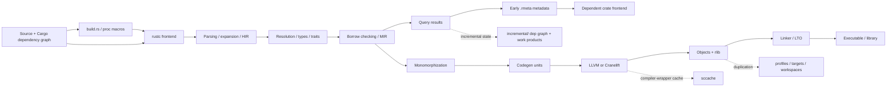
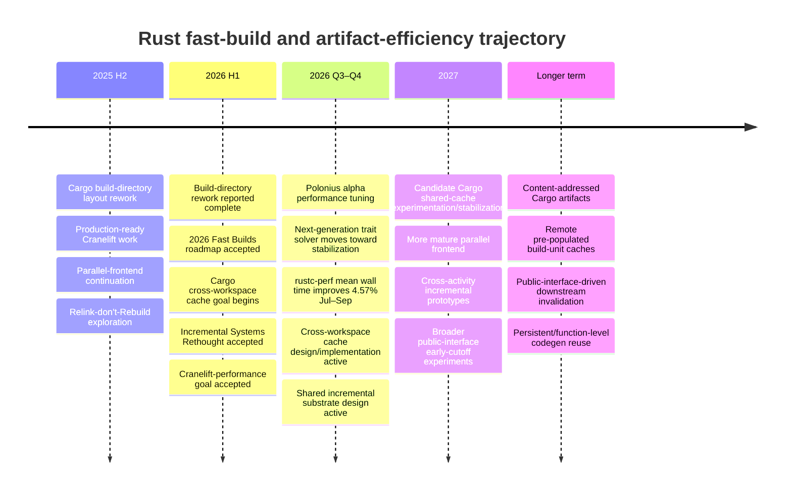
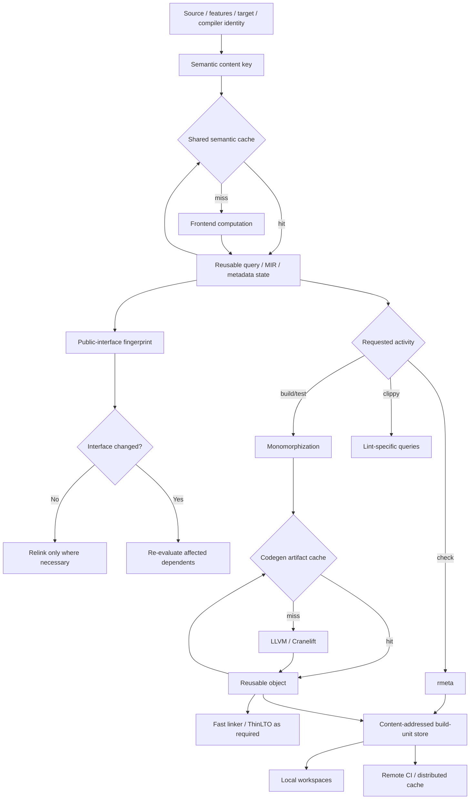

# Reducing Rust Compile Time and Build Disk Footprint: State of the Art and Roadmap as of October 2026

## Executive summary

Rust's compile-time problem is not one problem. It is the cumulative result of **expensive semantic analysis, aggressive monomorphization, LLVM-oriented code generation, large compiler-specific artifacts, conservative invalidation boundaries, and insufficient reuse of already-computed work across commands, profiles, workspaces, and machines**. The Rust compiler's query architecture is already incremental in an important sense, and Cargo already pipelines dependent crates using early-emitted `.rmeta` metadata, but today's reuse boundary remains much narrower than the semantic reuse that is theoretically possible. citeturn4view3turn17view3

The most important conclusion of this research is that **LLVM is no longer the best single explanation for slow Rust builds**. LLVM can dominate codegen-heavy builds, especially with optimization, debug information, and LTO, but a substantial fraction of avoidable cost occurs *before* or *around* LLVM: the same source can be re-analyzed for `check`, `build`, `test`, and Clippy; artifacts of identical dependencies are duplicated between workspaces; a private implementation change can trigger dependent recompilation; build scripts and procedural macros create opaque invalidation boundaries; and generic code is repeatedly monomorphized into consuming crates. Rust's own 2026 “Incremental Systems Rethought” project explicitly calls out the fact that `cargo check`, `cargo build`, and `cargo test` can rebuild a workspace multiple times despite sharing much semantic work. citeturn17view0turn4view2

There is therefore a useful distinction between two optimization classes:

**Stage acceleration** makes each execution of a compiler stage faster: parallel frontend compilation, Cranelift, rustc micro-optimizations, faster trait solving, faster borrow checking, alternative linkers, reduced debug information, more codegen units, and avoiding fat LTO.

**Work elimination** prevents the stage from running at all: incremental compilation, early cut-off based on public API changes, `cargo check`, sccache, cross-workspace artifact reuse, remote caches, dependency removal, precise `build.rs` invalidation, and eventually cross-activity incremental state shared by `check`/`build`/`test`/Clippy. For sufficiently large systems, the second category has the higher long-term ceiling because a skipped compile is better than a compiler made 20% faster. This is exactly the direction of the 2026 Cargo cross-workspace cache, Incremental Systems Rethought, and the continuing “Relink don't Rebuild”/public-API-hash work. citeturn19view0turn17view0turn11search7turn11search17

The upstream trajectory in 2026 is unusually promising:

- The official compiler-performance goal reports that earlier work on pipelining and backend parallelism delivered roughly **10–50%** improvements across broad benchmarks, while compiler performance improved by roughly **3× between 2016 and 2023**; the project now considers continued profile-driven optimization necessary because gains from straightforward local tuning are becoming harder. citeturn9view0
- A compiler-performance maintainer's September 2026 report measured a **4.57% mean wall-time reduction across rustc-perf between July 29 and September 28**, with 555 of 629 benchmarks improving. The LLVM 23 upgrade alone produced about **1.2% mean wall-time improvement**, while individual compiler fixes ranged from low-single-digit improvements to much larger wins on pathological workloads. citeturn8view0
- The experimental parallel frontend has already demonstrated approximately **20–30%+ overall compile-time improvements** in relevant configurations, although contention, scaling beyond moderate thread counts, correctness testing, and Cargo integration remain active engineering concerns. citeturn10search4turn10search7turn10search11turn10search18
- The 2026 Cranelift goal reports current incremental Zed builds **5% faster than LLVM without debug information and 12% faster with line-table-only debug information**, while rustc-perf single-crate measurements average roughly **10–15% faster** and range up to approximately **30%**; the new goal is a **2× speedup inside the Cranelift backend itself**. citeturn19view1
- Cargo's accepted 2026 cross-workspace-cache goal intends to store a given build unit once and reuse it between workspaces, initially conservatively and eventually potentially from a remote pre-populated cache. citeturn19view0
- “Incremental Systems Rethought” explicitly targets reuse between different rustc activities so that a `cargo build` can build on work previously done by `cargo check`, and ultimately seeks dynamic dependency tracking fine enough to avoid recompilation because of unused dependency functions or irrelevant compiler flags. citeturn17view0

For an unconstrained project, the best practical strategy today is therefore **not one magic flag**. It is a layered portfolio:

1. Make the edit loop use the cheapest semantic operation possible: usually `cargo check`.
2. Reduce development debug information and use a faster linker.
3. Remove unnecessary dependency/features and control generic/proc-macro expansion.
4. Keep incremental compilation for individual developers unless measurements prove otherwise.
5. Use **sccache instead of incremental compilation in cache-oriented CI**, because sccache currently cannot cache incrementally compiled Rust crates. citeturn13view0
6. Measure and pilot parallel frontend compilation and Cranelift on nightly where development latency warrants it.
7. Treat the coming Cargo cross-workspace cache, cross-activity incremental compilation, and public-interface invalidation as strategically important architectural changes rather than marginal compiler tuning.

There is **no defensible universal “Rust builds can be made X% faster” number** because the critical path varies dramatically between macro-heavy, trait-heavy, generic-heavy, codegen-heavy, link-heavy, and large dependency-graph workloads. The quantified figures in this report therefore distinguish **upstream measurements**, **exact/mechanistic savings**, and **planning estimates**. Planning ranges should be treated as hypotheses to validate against the benchmark matrix proposed at the end of this report.

## Cost anatomy: where time, space, and resources go

A useful model of the build pipeline is:



Rust's `rmeta`/`rlib` distinction is central to both compile time and disk use. An `.rmeta` contains compiler metadata but no linkable object code, which is why `cargo check` can stop before code generation and why Cargo can begin compiling a dependent library as soon as its dependency's metadata becomes available. An `.rlib`, by contrast, is an archive containing object code for codegen units, Rust metadata, and potentially embedded LLVM bitcode used for LTO. The rustc development guide explicitly notes that `-C embed-bitcode=no` can improve compilation time and reduce disk consumption when LTO bitcode is unnecessary. citeturn17view3

Rust's use of monomorphization deliberately exchanges compilation resources for runtime performance: generic functions are instantiated for concrete types, yielding specialized machine code but increasing compile time and binary size. Generic functions originating in dependencies can be instantiated in the downstream crate that uses them, so “dependency already compiled” does not mean all generic code from that dependency has already been code-generated. citeturn4view2 Macro expansion creates a related amplification mechanism: macros can generate large amounts of Rust code, while generic abstractions can produce large amounts of LLVM IR; the Rust Performance Book specifically recommends `-Zmacro-stats` and `cargo llvm-lines` when investigating those classes of compile-time explosion. citeturn4view0

Cargo's normal development defaults deliberately prioritize editability and debuggability rather than minimum artifact volume. Development profiles enable incremental compilation and traditionally produce substantial debug information; more codegen units provide more parallel compilation opportunities. Cargo documents the central tradeoff: more codegen units can reduce compilation latency through parallelism but can reduce optimization quality, while higher optimization levels make compilation longer. citeturn3view0

The resulting waste can be classified more precisely:

| Resource | What consumes it unnecessarily | Why it matters |
|---|---|---|
| **CPU** | Repeating frontend/query work across `check`/`build`/`test`; recompiling unchanged dependencies in another workspace; repeated generic monomorphization; excessive LLVM optimization; unnecessary build-script runs; fat LTO; broad downstream invalidation | Directly extends wall time when CPU-bound and raises CI cost. Rust's 2026 incremental work explicitly targets cross-activity duplication. citeturn17view0turn4view2 |
| **I/O** | Loading and writing incremental state; emitting `.rmeta`, `.rlib`, objects and debug information; scanning dependency metadata; archive creation; linker reads; cache reads/writes | Large dependency graphs can transition from CPU-bound to storage-latency/bandwidth-bound, particularly under high parallelism. Cargo exposes `deps`, `incremental`, and build-script output as distinct build-directory consumers. citeturn3view1 |
| **Memory** | Multiple concurrent rustc processes, multiple LLVM/codegen workers, parallel frontend state, ThinLTO backend jobs, linker working sets | Increasing parallelism eventually gives diminishing or negative returns when memory bandwidth, allocator contention, or RAM capacity becomes limiting; parallel-frontend work has explicitly encountered contention at larger thread counts. citeturn10search7turn22view0 |
| **Disk** | Incremental work products; duplicate dependency artifacts per workspace/profile/feature set; `.rlib` object code and LLVM bitcode; debug information; tests/examples; build-script output; compiler caches | Cargo's 2026 cache project explicitly identifies cross-workspace duplicate artifacts as both a rebuild and disk-usage problem. citeturn19view0turn17view3 |
| **Network** | Re-downloading remote build artifacts, uploading low-value cache entries, distributed-build inputs/toolchains, large debug-heavy outputs | Remote caching trades CPU against network and storage. It works best when artifacts are deterministic, cache keys are stable, and cache-hit compute avoided is worth more than transfer latency. sccache supports local and remote stores plus distributed compilation. citeturn13view0 |
| **Developer time** | Waiting for diagnostics, edit-build-test cycles, link serialization, CI queues, branch/profile cache misses | The relevant business metric is not compiler CPU alone but **critical-path latency to useful feedback**. Cargo's timings view explicitly exposes build-unit duration, concurrency, and the critical path. citeturn3view2 |

The difference between *aggregate CPU time* and *critical-path wall time* is particularly important. Splitting a crate may increase total compiler work because more metadata and crate boundaries exist, yet reduce wall time by permitting Cargo to schedule more work concurrently. Conversely, making a non-critical dependency 50% faster may produce essentially zero improvement in the developer-observed build time. Cargo's `--timings` report exists precisely to make this distinction visible. citeturn3view2

Build scripts deserve disproportionate attention. Cargo compiles and executes `build.rs` before the package, and, absent narrower change instructions, changes in package inputs may cause it to run again. `cargo::rerun-if-changed` and `cargo::rerun-if-env-changed` allow packages to constrain the invalidation surface. Build scripts can also compile large native dependencies, invoke code generators, and leave persistent data in `OUT_DIR`, so poor invalidation here can consume CPU, I/O, disk, and developer time simultaneously. citeturn14search16

A useful illustration of developer-time leverage is purely arithmetic. If an optimization saves **30 seconds on 20 builds per developer per day**, a 50-developer organization saves approximately **1,833 engineer-hours over 220 working days**. This is why even “only” 10–20% improvements to a frequently executed edit loop can justify much more engineering effort than larger percentage improvements to an infrequent release build.

## Structural diagnosis: what is fundamentally wrong

The word “wrong” needs qualification. Most of Rust's present architecture follows rational tradeoffs: strong static analysis, specialization through monomorphization, high-quality optimized machine code, rich diagnostics, independent crate compilation, and conservative correctness-oriented invalidation. The problem is that several boundaries that are good for compiler implementation or correctness are **coarser than the semantic dependencies developers actually care about**.

**The largest architectural mismatch is that the unit of compilation and persistence is too invocation-centric.** rustc has a demand-driven query system: computations are represented as memoized queries with dependency relationships, an architecture naturally suited to incremental computation. But persistent reuse does not currently constitute a universal, compiler-wide semantic database shared across arbitrary rustc activities. The 2026 Incremental Systems Rethought goal exists specifically because `check`, `build`, Clippy and tests do not share a sufficiently common incremental base. citeturn4view3turn17view0

That leads to a fundamental observation:

> Rust has sophisticated *incremental computation inside a compilation configuration*, but still lacks sufficiently general *incremental computation across compilation intentions*.

The official 2026 goal gives the concrete consequence: even codebases without important profile-specific conditional compilation can rebuild the workspace across a typical `cargo check` → `cargo build` → `cargo test` sequence. Its envisioned future includes dynamic dependencies precise enough that `-Clto` would not invalidate `cargo check`, that unused functions in dependencies would not force recompilation, and that compatible activities would share previous semantic work. citeturn17view0

A second architectural issue is **downstream invalidation based on implementation-sensitive metadata rather than a minimal semantic interface**. Rust metadata contains much more than a traditional C header: source-file information, exported items, traits, macros, and optionally encoded MIR; crate hashing incorporates HIR information, upstream crate hashes, filenames, and tracked compiler options. citeturn17view3 This richness enables Rust's semantics and cross-crate optimization, but also makes “nothing relevant to clients changed” harder to recognize.

The “Relink don't Rebuild” work attacks this boundary directly. Its motivating cases include comments, import reordering, or private implementation changes that currently cause reverse dependencies to be rebuilt even when their usable public interface has not changed. The proposed direction is stable identity plus an interface/public-API hash and early cut-off so that dependent compilation stops when externally observable metadata remains equivalent. citeturn11search7turn11search17 In the ideal case, a private change in a low-level library would compile that library and then merely relink consumers instead of re-type-checking and code-generating the entire reverse-dependency cone.

A third issue is **artifact identity and placement historically being workspace-local rather than content-centric**. Cargo's 2026 cross-workspace-cache proposal explicitly states that identical build units are currently stored locally to each workspace, causing both redundant compilation and redundant disk usage. The 2025 build-directory-layout work reorganized build data into smaller self-contained units as groundwork for finer locking, garbage collection, and shared caches; the 2026 project is now intended to make those units reusable between workspaces. citeturn16search6turn19view0

For a dependency artifact of size \(B\) duplicated identically across \(N\) workspaces, a content-shared cache reduces that subset from \(N B\) to approximately \(B\). The theoretical saving on that duplicated subset is:

\[
1-\frac{1}{N}
\]

That is **50% for two workspaces, 80% for five, and 90% for ten**. Overall target-tree reduction is that number multiplied by the fraction of artifacts actually identical and cacheable. This is one of the few areas where very large disk savings can be predicted mechanistically without pretending every Rust project has the same artifact mix.

A fourth issue is **generics crossing crate boundaries in a way that deliberately postpones work**. Monomorphization allows excellent runtime specialization but means generic library code may have to be instantiated in downstream crates rather than fully consumed as a precompiled opaque object. citeturn4view2 This creates a tension between Rust's “zero-cost abstraction” runtime objective and precompiled-library-style build reuse. It also explains why simply distributing a precompiled `.rlib` cannot eliminate all work associated with generic-heavy dependencies.

A fifth is the **instability and high dimensionality of Rust compiler artifacts**. `.rmeta` files record the rustc version, and rustc refuses metadata from a different compiler version; the artifact identity also depends on source, upstream hashes, targets, relevant compiler options, features, profile choices, panic strategy, code generation configuration, and—where relevant—host-side procedural macro/build-script behavior. citeturn17view3 This is why a universal crates.io-style binary artifact service is much harder for Rust than “compile each crate version once.” A useful artifact key is closer to:

```text
hash(
  rustc identity,
  host target,
  target triple,
  target features,
  crate source,
  enabled Cargo features,
  dependency artifact hashes,
  profile/codegen/debug/panic options,
  relevant environment,
  build-script outputs,
  proc-macro dependencies
)
```

This is an inference from rustc/Cargo's current dependency and metadata model, but it explains why **content-addressed organization-local caches are much more tractable than globally reusable package-registry binaries**. Cargo's own shared-cache plan starts conservatively—initially excluding difficult unit types such as build scripts and procedural macros—and only contemplates remote pre-population as a later extension. citeturn19view0

A sixth structural issue is that **proc macros and build scripts are intentionally powerful but relatively opaque build-system nodes**. A build system achieves maximal reuse when it knows the precise function from declared inputs to outputs. Arbitrary host programs, environment probes, native compilation, filesystem inspection, and code generation make such dependency discovery much harder. Cargo's explicit `rerun-if-*` interface is therefore a correctness/performance contract supplied by package authors rather than something Cargo can always infer perfectly. citeturn14search16

This architectural discussion has a strong analogue in build-systems research. Mokhov, Mitchell, and Peyton Jones's *Build Systems à la Carte* decomposes build systems along independent dimensions such as scheduling and rebuilding strategy and emphasizes early cut-off, dependency information, and different forms of persistent build knowledge. citeturn20search0turn24view0 Conceptually, Rust's current roadmap is moving from coarse “dirty crate/build-unit” reasoning toward a more precise mixture of dependency traces, semantic fingerprints, shared artifacts, and early cut-off. That comparison is an inference, but it is a useful way to understand why the highest-leverage Rust work is now increasingly build-system architecture rather than simply shaving instructions from rustc.

## Upstream state of play in October 2026

The following table summarizes the most consequential active or recently completed upstream initiatives.

| Upstream effort | State as of October 2026 | Why it matters | Quantified evidence / target |
|---|---|---|---|
| **Sustained rustc performance optimization** | Accepted 2026 project goal under “Fast Builds” | Profile-driven work on compiler hotspots, including regressions introduced by new semantic machinery | Official goal says rustc improved roughly **3× during 2016–2023** and earlier pipelining/backend work yielded **10–50%** improvements on broad benchmarks. citeturn9view0 |
| **Recent rustc micro-/algorithmic optimization** | Continuous | Removes overhead without changing architecture | Sept. 2026 maintainer report: **4.57% mean wall-time reduction** over roughly two months; LLVM 23 update around **1.2% mean**; individual pathological workloads saw much larger reductions. citeturn8view0 |
| **Parallel frontend** | Active stabilization/performance work; still experimental/nightly-oriented | Parallelizes work before code generation rather than relying mainly on Cargo crate concurrency and backend CGUs | Existing work has reported roughly **20–30%+ overall** reductions; scaling and contention remain limiting factors. citeturn10search4turn10search7turn10search11 |
| **Cranelift backend** | 2026 accepted performance goal | Replaces LLVM for fast development code generation where ultimate runtime optimization is less important | Current incremental Zed measurements: **5%** faster without debug info and **12%** with line tables; rustc-perf single-crate average around **10–15%**, up to ~**30%**; goal targets **2× backend speedup**. citeturn19view1 |
| **Cargo cross-workspace cache** | Accepted 2026 goal; initial nightly design/implementation planned | Eliminates both recompilation and duplicated identical dependency artifacts between workspaces | No universal measured percentage yet; duplicated subset has theoretical saving of \(1-1/N\) for \(N\) identical copies. Initial implementation intentionally conservative. citeturn19view0 |
| **Cargo build-directory rework** | 2025H2 work completed; foundation for 2026 cache | Groups smaller self-contained build units, enabling cache sharing, finer locking and GC | Architectural enabler rather than an independent end-user speedup. citeturn16search6turn16search9 |
| **Incremental Systems Rethought** | Accepted 2026 roadmap goal, 12-month design/implementation plan | Shares incremental work across `check`, `build`, potentially Clippy/test; tracks dependencies more precisely | Goal explicitly targets eliminating redundant full recompilation between compatible activities. citeturn17view0 |
| **Relink don't Rebuild / `public_api_hash`** | Initial goal period did not fully complete; implementation/tracking continued in 2026 | Avoids rebuilding reverse dependencies when a crate's externally meaningful interface did not change | Potential saving is the entire downstream rebuild cone for private-only changes; no credible universal percentage yet. citeturn11search7turn11search17 |
| **Polonius alpha borrow checker** | Enabled experimentally/nightly in 2026 with optimization ongoing before stabilization | Improves borrow-check semantics but initially risks front-end regressions | Testing over leading crates found relatively few significant regressions, though pathological cases outside the top set reached **2–3×** before further tuning. citeturn9view3 |
| **Next-generation trait solver** | Nightly-default phase in 2026, stabilization planned | Replaces a major semantic subsystem and must avoid making trait-heavy compilation worse | Rust's 2026 report says almost all of the top ~20,000 tested crates had effectively comparable compile performance after extensive optimization of quadratic/exponential cases. citeturn9view4 |
| **ThinLTO** | Mature LLVM technology; supported through Rust profiles | Retains much of whole-program optimization without fat-LTO's monolithic memory/time model | Cargo states ThinLTO takes **substantially less time** than fat LTO while often obtaining similar gains. LLVM describes ThinLTO as parallel and incrementally cacheable. citeturn3view0turn22view0 |
| **Crate metadata / pipelining** | Established | Dependent frontend work begins before dependency codegen completes | rustc emits `.rmeta` early precisely to let Cargo pipeline dependency compilation. citeturn17view3 |

Two emerging trends are especially important.

First, **the project is becoming willing to optimize different workflows with different backends**. Rust no longer needs to assume that the backend best suited for maximum optimized runtime performance must also be the backend used for a developer's edit-build-run loop. Cargo's current build-performance guide explicitly recommends experimenting with the Cranelift backend on nightly for development, accepting worse generated-code runtime performance in exchange for faster code generation. citeturn17view4turn19view1

Second, **incremental compilation is being rethought above the existing query layer rather than merely tuned within it**. The proposed destination is essentially a shared semantic substrate from which different output activities can diverge late. A `check` could provide parsing/type/MIR-related work to a subsequent `build`, while `build` adds machine code; a subsequent `test` could reuse the compatible common portion rather than starting a distinct incremental universe. citeturn17view0

The “Relink don't Rebuild” idea is complementary, not competing. Cross-activity reuse asks **“can this invocation reuse computations from another kind of invocation?”** Public-interface early cut-off asks **“did this changed crate produce any change that consumers need to observe?”** Cross-workspace caching asks **“has somebody already materialized exactly this build unit somewhere else?”** The ideal future architecture needs all three.

MIR is important here as the semantic boundary between much of the frontend and backend. Encoded MIR may appear in crate metadata when code generation needs it, while `cargo check` deliberately omits some codegen-oriented metadata for performance. citeturn17view3 The long-term opportunity is therefore not simply “make MIR optimization faster,” but to make the dependencies surrounding MIR, monomorphization, metadata, and codegen sufficiently precise that transformations are performed only when an output actually needs them.

ThinLTO deserves one caveat. LLVM's ThinLTO documentation describes a scalable thin-link index, parallel backend optimization, a persistent ThinLTO cache, pruning policies, and even distributed ThinLTO backend execution. citeturn22view0 These capabilities are architecturally relevant, but **standard Rust `lto = "thin"` should not be assumed automatically to expose every Clang/linker ThinLTO cache or distributed-ThinLTO mechanism**. Rust commonly orchestrates LLVM code generation itself. Linker-plugin LTO is a separate advanced mode; the rustc metadata documentation notes that `-C linker-plugin-lto` can replace native objects in an `rlib` with bitcode. citeturn17view3

## Mitigation portfolio and quantified opportunities

The table below separates measured evidence from planning estimates. **M** means directly measured/published upstream evidence; **E** means the effect can be expressed mechanistically; **P** means an engineering planning range, not a Rust-project guarantee.

| Technique | Compile-time opportunity | Disk opportunity | Complexity | Main tradeoff |
|---|---:|---:|---|---|
| **Use `cargo check` for the primary edit loop** | **P: ~20–70%** versus a codegen/link-heavy `cargo build`; actual saving equals the fraction of the build spent after semantic checking | **P: often 20–60% less newly generated local build data** because no linkable object code is needed | Low | Does not produce runnable/test binaries. `.rmeta` specifically exists for fast checking without codegen. citeturn17view3 |
| **Development debug info: `line-tables-only`; dependencies `debug=false`** | **P: ~5–25%** in debug/codegen/link-heavy builds | **P: ~20–60%** in debug-info-heavy target trees | Low | Full debugger variable/type experience requires a separate debug profile. Cargo now explicitly recommends this configuration for faster builds, links and smaller targets. citeturn17view4 |
| **Faster linker: LLD, mold, wild as appropriate** | **E:** total saving \(=L(1-1/S)\), where \(L\) is link share and \(S\) linker speedup. Example: link=30%, 3× faster ⇒ **20% total** | Usually **0–5%** | Low–Medium | Platform/C/C++ integration compatibility; benefit is small when linking is not on the critical path. Cargo explicitly recommends evaluating alternative linkers. citeturn17view4 |
| **Incremental compilation for developer builds** | Potentially very large after small local edits; zero benefit on a cold first build | Disk cost **increases** by the incremental cache | Low | Trades disk/I/O for reduced recompilation. Cargo states incremental saves additional information to disk for future recompiles. citeturn3view0 |
| **Disable incremental compilation where cache sharing dominates** | May make an individual machine's repeated edits slower, but enables better sccache reuse | **E:** directly removes that profile's `incremental/` footprint | Low | Particularly appropriate for clean/ephemeral CI rather than local editing. sccache cannot cache incrementally compiled Rust crates. citeturn13view0 |
| **sccache local/remote** | **E:** approximate saving ≈ `cacheable_compile_share × hit_rate − cache overhead`; with 80% cacheable work and 80% hits, up to ~64% of compile work is avoidable before transfer overhead | Local target may shrink in ephemeral CI; total storage shifts into shared cache | Medium | Cache-key quality, network latency, storage, eviction, toolchain identity. Rust binaries/proc macros and other system-linking crate types have caching restrictions. citeturn13view0 |
| **sccache distributed compilation / remote execution** | High when CI has many independent expensive cache misses and abundant remote workers | Little inherent target-tree reduction; adds remote artifact/cache storage | High | Network/toolchain provisioning, scheduler overhead, security, path normalization, observability. sccache provides Rust distributed-compilation support. citeturn13view0 |
| **ccache** | Essentially **0% for direct rustc compilation**; useful for C/C++ compiled from `build.rs` | Only native-subbuild cache effects | Medium | ccache identifies itself as a **C/C++ compiler cache**; use sccache for rustc. citeturn22view1 |
| **Experimental parallel frontend** | **M: ~20–30%+ overall** on suitable workloads; diminishing returns with thread count | ~0% | Medium | Nightly/experimental status, higher instantaneous CPU/RAM, contention. citeturn10search4turn10search7turn10search11 |
| **Cranelift dev backend** | **M:** Zed incremental **5–12%**, rustc-perf single-crate average **10–15%**, some ~**30%**; further 2× backend target underway | Project-dependent; likely modest rather than transformative | Medium | Nightly/unstable Cargo integration, target limitations and worse generated runtime performance. citeturn19view1turn17view4 |
| **Remove unused dependencies/features** | **E:** saves exactly the removed subgraph's compile/codegen/link work | **E:** removes that subgraph's artifacts | Low–Medium | Feature behavior may be semantically important. Cargo's current guide explicitly recommends auditing both dependencies and features. citeturn17view4 |
| **Fix build-script invalidation** | Can remove entire native/codegen phases on irrelevant edits | Prevents repeated/generated-output churn, but retained outputs still occupy disk | Low–Medium | Requires package-level correctness discipline with `rerun-if-changed` / `rerun-if-env-changed`. citeturn14search16 |
| **Reduce macro/generic IR explosion** | Can range from negligible to dominant on pathological crates | Often reduces binary/rlib/object size as well | Medium–High | Can require API/code redesign. `cargo llvm-lines` and macro statistics help identify offenders. citeturn4view0turn4view2 |
| **Tune codegen units** | More CGUs can shorten compilation via parallelism; fewer improve optimization | More CGUs may add object/archive overhead | Low | More parallelism can reduce generated-code quality. Cargo defaults differ between incremental and non-incremental builds for this reason. citeturn3view0 |
| **No cross-crate LTO for development; ThinLTO for performance-sensitive release** | `lto="thin"` is substantially faster than fat LTO; `"off"` is cheaper still | ThinLTO/cache may require extra temporary/cache storage | Low | Runtime optimization may decrease when LTO is reduced. citeturn3view0turn22view0 |
| **`-C embed-bitcode=no` where LTO will never need it** | rustc docs explicitly identify a compile-time benefit | **E:** saves the embedded LLVM-bitcode sections in affected objects/rlibs | Low–Medium | Incompatible with later workflows that need that bitcode for LTO. citeturn17view3 |
| **`strip` final deliverables** | Negligible compiler-time impact | Can strongly reduce final executable/library size, but typically little effect on the bulk of intermediate `target/` data | Low | Debug/symbolication impact. Cargo supports stripping symbols/debuginfo through profile settings. citeturn3view0 |
| **Shared global `target` directory today** | Avoids duplicate dependency compilation across selected workspaces when build identity matches | Can dramatically reduce duplicate artifacts | Low–Medium | Coarse cleaning, locking and workspace-output semantics; Cargo's official cross-workspace cache is intended to provide the benefits without these drawbacks. citeturn19view0 |
| **Future Cargo cross-workspace cache** | Potentially near-complete elimination of repeated identical dependency build units | **E:** duplicated subset saving \(1-1/N\) across \(N\) workspaces | Medium upstream; Low eventual user complexity | Initially conservative; proc macros/build scripts are harder. citeturn19view0 |
| **Future public-API early cut-off / RDR** | **E:** can eliminate the entire reverse-dependency compile cone after an implementation-only change | Avoids creation/replacement of downstream incremental work products | High upstream | Correct interface fingerprinting must account for metadata, spans, generics and codegen-observable information. citeturn11search7turn11search17 |
| **Future cross-activity incremental reuse** | For compatible workflows can eliminate repeated frontend work between `check`, `build`, tests and perhaps Clippy | May *reduce* duplicate caches but could create a larger shared semantic store | Very High upstream | Requires fingerprints and dependency representations stable enough across compilation activities. citeturn17view0 |

The broad planning ranges above are deliberately non-additive. A 20% debug-info win and a 20% linker win do **not** imply 40% overall improvement: reducing one stage changes the fraction contributed by every other stage.

### Incremental compilation versus sccache

This is one of the most important operational choices.

For a developer repeatedly editing a single workspace, rustc incremental compilation usually has the favorable semantic granularity: it can reuse work *inside* a crate after a small edit. Cargo's development profile therefore enables it by default. citeturn3view0

For clean or frequently replaced CI workers, incremental state has much lower reuse probability. sccache instead reuses complete compiler outputs across machines and checkouts. But its Rust documentation explicitly says **incrementally compiled crates cannot be cached**, producing a genuine policy conflict. citeturn13view0

A good default architecture is therefore:

```text
Developer workstation:
    incremental = true
    optional local sccache mainly for non-incremental dependencies / other workloads

Clean CI / ephemeral runners:
    incremental = false
    remote sccache = enabled
    normalize checkout paths
    measure hit rate and download/upload latency

Long-lived CI branch worker:
    benchmark both models
    choose whichever wins p50/p95 critical-path latency
```

sccache's path-normalization/base-directory support is particularly important when CI checks out the same source under different absolute paths, because otherwise path identity can unnecessarily fragment cache keys. citeturn13view0

### Distributed builds and remote execution

Rust's crate graph exposes a large amount of coarse parallelism: independent crates and compiler invocations can be distributed. sccache provides distributed compilation support for Rust and can back caches with remote storage services. citeturn13view0 This is much easier to deploy than attempting to distribute one rustc frontend invocation.

Remote execution makes economic sense when:

\[
T_{\text{remote}}
=
T_{\text{queue}}
+
T_{\text{upload}}
+
T_{\text{compile}}
+
T_{\text{download}}
<
T_{\text{local critical path}}
\]

It therefore performs poorly for tiny crates and exceptionally well for expensive independent compilation units, particularly when the scheduler can overlap them.

LLVM now also documents **Distributed ThinLTO**, where ThinLTO backend jobs can be delegated through an external distributor using LLD. citeturn22view0 This is interesting for the Rust architecture, but should be treated as an advanced LLVM capability rather than a turnkey Cargo feature today.

### LTO, PGO, and release-build strategy

For development, whole-program optimization is usually the wrong side of the latency/runtime tradeoff. Cargo's profile model distinguishes fat LTO from ThinLTO and notes that ThinLTO takes substantially less compilation time with similar runtime gains in many cases. citeturn3view0 LLVM's design explains why: ThinLTO merges compact module summaries and performs optimization in parallel module backends rather than constructing one monolithic combined module; it also has explicit incremental cache support at the LLVM/linker layer. citeturn22view0

A sensible profile hierarchy is therefore:

```toml
# Conceptual policy, not a universal prescription

[profile.dev]
opt-level = 0
debug = "line-tables-only"
incremental = true

[profile.dev.package."*"]
debug = false

# Release-performance profile:
# prefer thin LTO first; justify fat LTO with benchmarks
[profile.release]
lto = "thin"
```

Cargo's own current build-performance guide recommends the development debug-information settings shown above. citeturn17view4

Profile-guided optimization is different. Rust's PGO implementation collects execution profiles from an instrumented program and then uses those profiles to guide optimizations such as inlining, layout and register allocation. citeturn22view2 For the *application being built*, this necessarily adds stages—instrumented compilation, representative execution, profile processing and optimized recompilation—so PGO is **not a strategy for shortening everyday builds**. It belongs in a high-value release pipeline where runtime performance justifies additional build cost.

There is, however, a compiler-tooling-side lesson: the September 2026 rustc performance report notes a Clippy PGO experiment with a best case around **18% wall-time improvement**, demonstrating that optimizing the compiler/tool itself according to representative workloads can materially change developer-facing latency. citeturn8view0

### Precompiled crates and package-registry artifacts

A universal “download precompiled crates from crates.io” solution is tempting but runs into four structural problems:

1. `.rmeta` is compiler-version-specific; rustc refuses metadata produced by another compiler version. citeturn17view3
2. Cargo features, target triples, host triples, target features, optimization/debug settings and relevant compiler flags create a large artifact matrix. citeturn3view0turn17view3
3. Generic library code can still require downstream monomorphization. citeturn4view2
4. Build scripts and procedural macros introduce host execution and environmental dependencies that are more difficult to represent as simple static package artifacts. citeturn14search16

The better intermediate architecture is therefore a **content-addressed organization/workgroup cache populated on demand**, exactly the direction Cargo's cross-workspace project is taking. The official proposal explicitly says its shared cache could later be pre-populated from a remote cache for CI. citeturn19view0 A public registry artifact service becomes more plausible only after artifact identity, compiler compatibility, provenance, cache garbage collection and trust/attestation semantics become standardized.

### Filesystem and artifact layout

Fast storage matters disproportionately because compilation creates many objects, metadata files, incremental work products, archives and linker inputs. But moving `target/` to a faster SSD or RAM disk treats symptoms rather than invalidation. It is most useful once measurements show I/O wait rather than CPU on the critical path.

The strategic filesystem improvement is instead Cargo's build-directory restructuring: make independently reusable build units self-contained, then deduplicate and garbage-collect them centrally. That is precisely the prerequisite identified by the 2025H2 layout project and the 2026 cross-workspace-cache effort. citeturn16search6turn19view0

## Practical roadmap

For an unspecified codebase, the recommended order should maximize **expected benefit per unit of ecosystem disruption**, while keeping experimental mechanisms behind opt-in CI lanes.

| Horizon | Actions | Expected portfolio effect | Complexity / risk |
|---|---|---|---|
| **Immediate: days to weeks** | Establish benchmark suite; make `cargo check` the edit-feedback default; enable Cargo timings; use `line-tables-only` and disable dependency debuginfo; evaluate faster linker; audit dependency/features; tighten build-script invalidation; measure `target/` categories | **Planning estimate: 10–35% edit-loop reduction** in a typical unoptimized setup; **10–50% disk reduction** where full debug info is a major target consumer | Low. Mostly configuration and measurement. Cargo officially recommends most of these build-performance measures. citeturn17view4turn3view2 |
| **Near term: weeks to months** | Deploy remote sccache in clean CI with `incremental=false`; normalize paths; instrument hit rates and bytes; tune cache retention; audit generic/macro bloat; split truly critical-path crates where beneficial; tune CGUs | **Warm CI:** potentially tens of percent to >50% when cacheable share × hit rate is high; disk reduction depends on whether local duplicate targets are removed or merely supplemented by a remote cache | Medium. Cache correctness, network, storage and developer/CI profile divergence must be managed. citeturn13view0turn4view0 |
| **Experimental: one to six months** | Benchmark nightly parallel frontend and Cranelift separately and together; establish runtime-performance guardrails for Cranelift-built tests; test alternative linkers across platforms | Parallel frontend has reported **~20–30%+** potential; Cranelift currently **~5–15% typical measured development wins**, with larger cases | Medium. Nightly/unstable dependencies and memory/compatibility issues. citeturn10search11turn19view1 |
| **Strategic: six to eighteen months** | Pilot Cargo cross-workspace cache as it becomes experimentally available; evaluate shared `build-dir` design; test Incremental Systems Rethought and public-API-hash/RDR prototypes; redesign CI around semantic/content caches rather than copying entire `target/` trees | Potentially **eliminates whole classes of redundant builds**, especially multi-workspace dependency duplication and `check`→`build` work | High but primarily upstream. citeturn19view0turn17view0turn11search17 |
| **Long term: eighteen months and beyond** | Push toward stable content-addressed build units, public-interface early cut-off, cross-activity semantic caching, remote pre-population, robust artifact provenance/GC; investigate function-level codegen caches and persistent compilation services | Ceiling is dramatically higher than ordinary compiler tuning because entire compiler stages or reverse-dependency cones can disappear | Very High. Requires coordinated rustc, Cargo, proc-macro/build-script and tooling changes. citeturn17view0turn19view0turn19view1 |

The percentages in the first two rows are planning bands, not published Rust guarantees. Their purpose is to prioritize experiments. The later architectural projects have potentially much larger *conditional* benefits: if a private change currently forces 80% of a workspace's critical path to rebuild, correct interface early cut-off can theoretically eliminate most of that 80%; if there is no substantial reverse-dependency cone, it provides almost nothing.

The roadmap can be placed in the larger upstream timeline as follows:



The historical and 2026 portions reflect project-goal and compiler-performance reports; post-2026 entries are the logical direction of accepted goals rather than committed Rust release dates. The 2026 goals milestone itself extends into 2027, and several projects explicitly describe stabilization as future or potentially beyond the goal period. citeturn17view1turn19view0turn17view0

The highest-priority ecosystem changes should therefore be ranked as follows.

**First: eliminate unnecessary work with information Rust already has.** Cargo knows dependency graphs better than an external compiler wrapper and can eventually construct stronger cache identities than sccache's command-line inference; the cross-workspace goal explicitly makes this comparison. citeturn19view0

**Second: make incremental state semantic rather than command-specific.** `check`, `build`, tests and Clippy should ideally diverge only at the point where their required outputs diverge. That is the central idea of Incremental Systems Rethought. citeturn17view0

**Third: make dependency invalidation interface-sensitive.** A private change should not require semantic reprocessing of all consumers. This is the highest-potential improvement for large layered workspaces where foundational libraries have large reverse-dependency cones. citeturn11search7turn11search17

**Fourth: provide explicit latency-oriented compilation modes.** Parallel frontend plus a faster codegen backend such as Cranelift gives Rust a path toward a “development compiler” optimized for low latency while LLVM remains available for optimized production binaries. The 2026 Cranelift goal even investigates more radical designs including persistent in-memory machine-code caches, JIT compilation, and interpretation of infrequently executed functions. citeturn19view1

**Fifth: make build outputs disposable and globally manageable.** Cross-workspace content sharing needs automatic eviction/GC; otherwise one merely converts duplicated workspace targets into an indefinitely growing central cache. Cargo's proposed shared cache explicitly includes centralized cleanup as one of its intended advantages. citeturn19view0

## Metrics, benchmark design, and conclusions

Optimizing Rust compilation without a controlled workload is especially dangerous because almost every lever exchanges one resource for another. More threads exchange memory for wall time. Incremental compilation exchanges disk/I/O for CPU. Remote caching exchanges CPU for network and storage. More codegen units exchange generated-code quality for parallelism. Cranelift exchanges output optimization for backend latency. LTO exchanges build cost for runtime performance. Cargo's own build-performance documentation consequently recommends measuring the workflows that actually matter, rather than assuming every optimization helps every project. citeturn17view4

A serious benchmark suite should contain at least these scenarios:

| Scenario | What it diagnoses | Primary metrics |
|---|---|---|
| **Cold clean build** | Absolute compiler/dependency cost | Wall time, CPU-seconds, peak RSS, read/write bytes |
| **Warm clean build** | Filesystem page-cache sensitivity | Same metrics versus cold |
| **No-op build** | Build-system overhead and fingerprint checking | Wall time, file stats, rustc processes started |
| **One-line private leaf edit** | Fine-grained incremental performance | Rebuilt crates, incremental hit rate, wall time |
| **Private edit in foundational crate** | Downstream over-invalidation | Reverse dependencies rebuilt, wasted CPU |
| **Public API edit** | Legitimate reverse-dependency rebuild cost | Critical path and downstream count |
| **Generic-heavy edit** | Monomorphization/codegen amplification | LLVM IR lines, mono items, backend CPU |
| **Macro-heavy edit** | Expansion amplification | Expanded-code size, macro time |
| **Build-script input edit** | Native/code-generation invalidation | build.rs execution count and output bytes |
| **`cargo check` → `cargo build`** | Cross-activity duplication | Repeated frontend work; future Incremental Systems Rethought KPI |
| **`build` → `test`** | Profile/target duplication | Rebuilt units and time |
| **Feature switch** | Artifact/cache fragmentation | Cache miss reasons and duplicated bytes |
| **Branch switch and back** | Cache persistence/value | sccache/Cargo-cache hit rate |
| **Clean CI with warm remote cache** | Shared-cache effectiveness | Critical path, hit rate, transferred bytes |
| **Release without LTO / ThinLTO / fat LTO** | Build/runtime tradeoff | Build time, max RSS, binary size, runtime benchmark |
| **LLVM vs Cranelift** | Backend contribution | Backend time and test/runtime duration |
| **Serial vs parallel frontend** | Available frontend parallelism | Wall time, total CPU, max RSS, scalability per thread count |

Cargo provides `cargo build --timings`, including unit durations, concurrency and critical-path information, and its own documentation specifically recommends using timings to find slow dependencies, duplicated crate versions and critical-path crates. citeturn3view2 At the compiler level, rustc's performance work and rustc-perf should be the reference methodology when evaluating compiler changes rather than relying on one application alone; the September 2026 compiler report's 629-benchmark aggregate illustrates why broad suites matter. citeturn8view0

At minimum, collect these metrics for every benchmark:

**Latency:** p50/p95 wall time for `check`, build, test and release; time to first useful diagnostic; link-only time; longest critical-path build unit.

**CPU:** total user/system CPU-seconds; CPU instructions and cycles where available; time apportioned to frontend, query evaluation, MIR, monomorphization, LLVM/Cranelift and linking.

**Parallelism:** average active compiler jobs, frontend thread utilization, CPU utilization, critical-path idle gaps, and scaling efficiency at 1/2/4/8/16+ cores.

**Memory:** peak resident set of individual rustc processes and whole build; page faults; swap activity. This matters because a nominally faster parallel configuration can become much slower after memory pressure.

**Disk:** total build-directory bytes plus separate sizes for `deps/`, `incremental/`, build-script outputs, `.rlib`, `.rmeta`, object/debug files, final binaries and compiler caches. Cargo's build-cache layout documents these categories. citeturn3view1

**Cache metrics:** invocation hit rate is not enough. Track **time-weighted hit rate** and **byte-weighted hit rate**, because missing one 40-second dependency matters more than hitting twenty 200-ms crates. Record miss reason, cache lookup latency, upload/download bytes, compression CPU, and eviction rate.

**Invalidation quality:** after each synthetic edit, record how many crates, queries and codegen units were invalidated versus how many *should semantically have changed*. This becomes the key KPI for Relink-don't-Rebuild and Incremental Systems Rethought. citeturn11search7turn17view0

**Developer economics:** convert saved latency to engineer-hours:

\[
\text{annual hours saved}
=
\frac{
D \times B \times S \times W
}{3600}
\]

where \(D\) is developer count, \(B\) builds per developer-day, \(S\) seconds saved per build, and \(W\) working days per year. This prevents spending weeks optimizing a 20-minute release build that runs once a week while ignoring a 15-second check that every engineer executes hundreds of times.

For artifact work, add a **duplication ratio**:

\[
\text{duplication ratio}
=
\frac{\text{physical build/cache bytes}}
{\text{bytes of unique content-addressed build units}}
\]

A ratio near 1 means there is little opportunity for cross-workspace deduplication; a ratio of 5 means an ideal shared store could theoretically remove about 80% of those duplicate bytes. This metric maps directly to Cargo's 2026 cross-workspace-cache objective. citeturn19view0

For remote caches, the most useful objective is not raw hit rate but **avoided compute per transferred byte**:

\[
\text{cache value density}
=
\frac{\text{local CPU-seconds avoided}}
{\text{network bytes + storage bytes}}
\]

This naturally discourages uploading cheap, enormous artifacts and prioritizes expensive reusable ones.

The architectural end-state that emerges from all of this research is substantially different from today's conventional model:



That model combines four ideas already visible separately in current Rust work: query-driven computation, public-interface early cut-off, cross-workspace content reuse, and cross-activity incremental state. citeturn4view3turn11search7turn19view0turn17view0

The most consequential conclusion is therefore that **Rust's compile-time future is likely to be won more by making compilation *less necessary* than by making LLVM or rustc individually faster**. Compiler micro-optimization remains valuable—the 4.57% aggregate improvement in only two months of 2026 work shows that—and parallel frontend/Cranelift can plausibly deliver meaningful additional latency reductions. citeturn8view0turn19view1 But those improvements remain bounded by Amdahl's law: a compiler twice as fast still wastes half its time if it is compiling something that did not semantically need recompilation.

The highest-value long-term direction is consequently a Rust toolchain in which **semantic work survives changes in command, identical build units survive changes in workspace and machine, implementation-only changes stop at the public interface, codegen is deferred until an output actually requires it, and artifact storage is content-addressed and automatically garbage-collected**. The accepted 2026 Cargo and compiler goals show that Rust upstream is now explicitly moving toward several pieces of that architecture. citeturn17view0turn19view0turn11search17

For projects acting before those efforts stabilize, the pragmatic hierarchy is clear: **measure first; use `cargo check`; reduce debug information; remove dependency and code-generation bloat; fix build-script invalidation; use the fastest appropriate linker; keep local incremental builds; use sccache-oriented non-incremental CI; then experimentally evaluate parallel frontend and Cranelift.** Cargo's current official build-performance guidance aligns closely with this ordering. citeturn17view4turn13view0

The overarching engineering objective should not be “make rustc fast.” It should be **minimize the amount of work between a source edit and trustworthy feedback, while storing each expensive result no more times than its semantic identity requires**. That objective simultaneously attacks CPU, memory pressure, disk usage, network waste, CI cost, and—most importantly—developer waiting time.