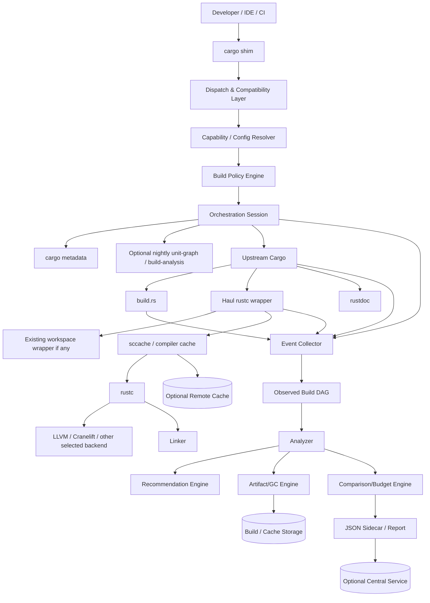
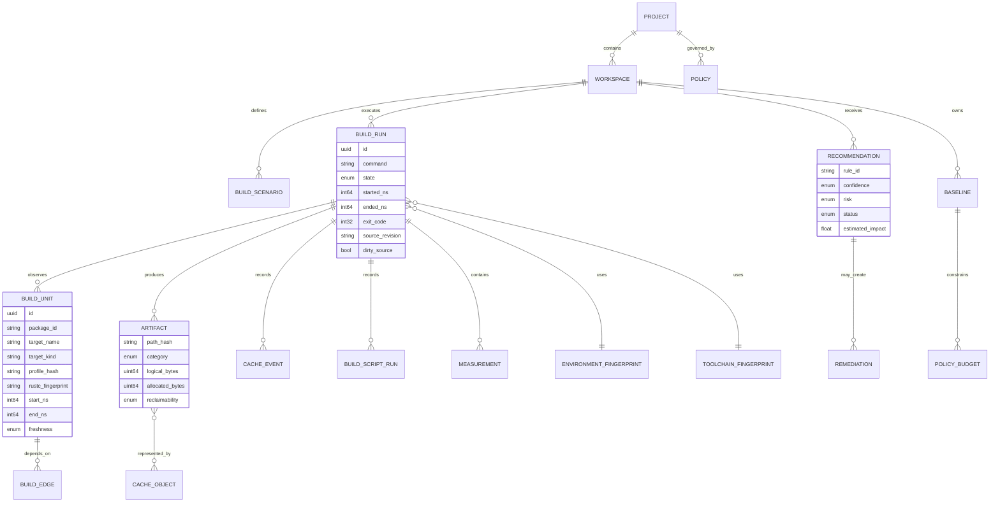
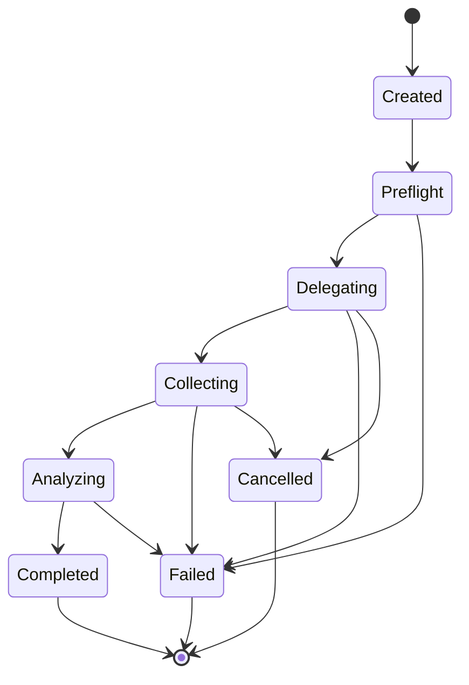
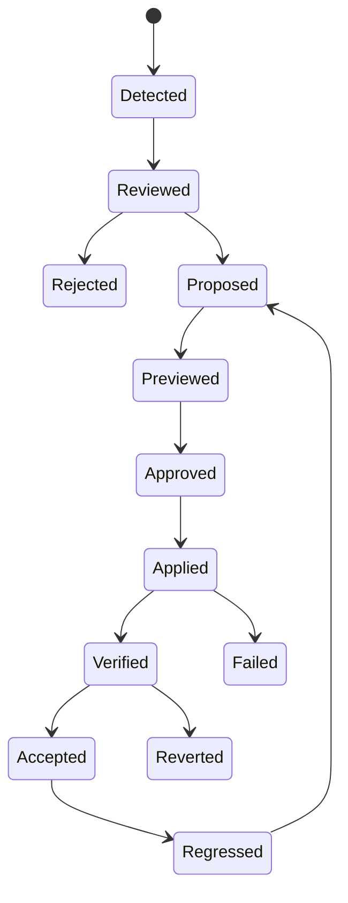
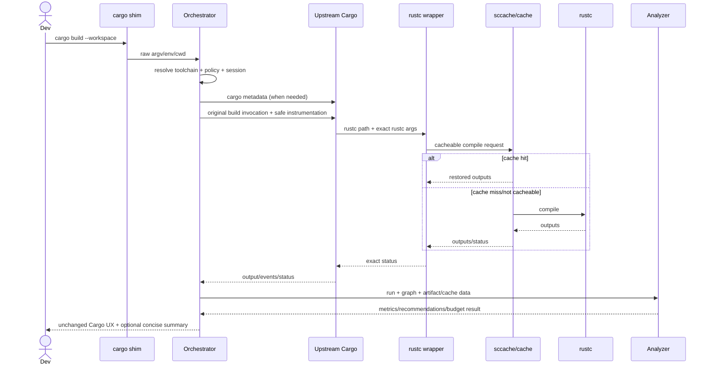
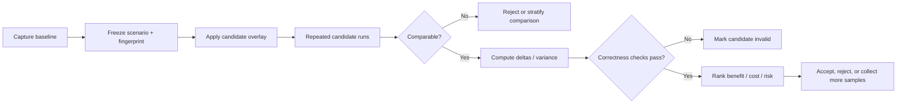
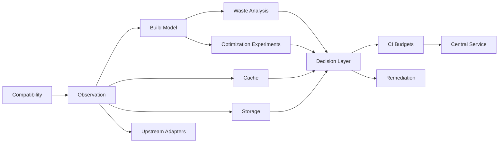

# Haul: Drop-In Cargo Replacement for Faster, Leaner Rust Builds

## Executive Summary

**Document status:** implementation-ready product and engineering specification  
**Reference date:** October 5, 2026  
**Current stable Rust baseline:** Rust 1.99.0, released October 1, 2026. citeturn15view14  
**Working product name:** **Haul**  
**Canonical executable:** `haul`  
**Drop-in compatibility executable:** `cargo`  
**Primary operating model:** authoritative wrapper/orchestrator around upstream Cargo, rustc, linkers, compiler caches, artifact stores, and CI rather than a reimplementation of Cargo's package-manager semantics.

### Product thesis

Haul should make the project's build command look and behave like Cargo to users and tooling while inserting a policy, observability, caching, lifecycle-management, and optimization layer around the existing Rust toolchain.

The critical architectural decision is **not to fork or reimplement Cargo's resolver, package manager, or compiler command-generation logic in the initial product**. Cargo's documented interface for third-party tools is its command-line interface, `cargo metadata`, and machine-readable build messages; using Cargo as a Rust library remains unstable. citeturn15view1 The replacement therefore becomes authoritative at the process-orchestration boundary while treating upstream Cargo and rustc as semantic executors.

The intended command path is:

```text
developer / IDE / CI
        │
        ▼
      cargo                 ← Haul drop-in shim
        │
        ├── policy / config / capability resolution
        ├── workspace + graph analysis
        ├── build-state and cache policy
        ├── artifact-directory policy
        ├── resource policy
        └── instrumentation
                │
                ▼
         upstream Cargo
                │
        ┌───────┼─────────────┐
        ▼       ▼             ▼
   build.rs   rustc        rustdoc
                │
         rustc wrapper
                │
       ┌────────┼───────────┐
       ▼        ▼           ▼
   sccache   compiler     linker
              backend
```

This boundary is intentionally aligned with current upstream work. Cargo already exposes stable machine-readable compilation messages and versioned metadata, while nightly Cargo has experimental `--unit-graph` and `-Zbuild-analysis` facilities for more accurate build-unit graphs, timings, rebuild reasons, and historical sessions. citeturn15view1turn16view0turn16view1 Cargo's 2026 roadmap is also developing a cross-workspace build cache, while the compiler roadmap is explicitly redesigning incremental compilation so compatible `check`, `build`, `test`, and potentially Clippy invocations can share work. citeturn16view4turn16view5

> **Revision (2026-10-11): fast by default.** The product goal is that a developer who replaces `cargo` with Haul on any project *immediately feels that builds are faster* — the way Bun felt next to npm — with no configuration. Haul may therefore, **by default**, change anything that leaves the built program behaving identically: linker, debug-information level, compiler parallelism, a global content-addressed artifact cache, and, where it manages the toolchain itself, nightly-only compiler capabilities once proven. Exact upstream output remains one switch away (`mode = "compat"`, and `haul upstream`). Settings the user made explicitly are never overridden. Every claimed improvement must be backed by a recorded entry of the speed index (`benchmarks/README.md`). Where the rules below and earlier sections speak of optimizations as opt-in, this revision supersedes them; the rest of the specification stands.

The design therefore follows four rules:

1. **Preserve Cargo compatibility first.** Unknown flags, commands, external subcommands, stdout formats, environment variables, exit statuses, terminal behavior, lockfiles, and package-selection semantics belong to upstream Cargo. Optimizations that keep program behaviour identical are on by default (see the revision above); `mode = "compat"` turns them all off.
2. **Eliminate work before accelerating it.** Duplicate builds, avoidable invalidation, unshared workspaces, unused feature variants, unnecessary linker/codegen work, stale artifacts, and ineffective caches are the highest-value optimization targets.
3. **Never trade correctness for cache hits.** Any optimization that changes compilation inputs, artifacts, profiles, linkers, incremental behavior, or build-script execution must have explicit provenance and validation: it is recorded in every run, measured by the speed index, and verified by the benchmark workloads' own test suites before it becomes a default.
4. **Exploit upstream improvements instead of competing with them.** Experimental adapters shall be capability-gated. As native Cargo features stabilize, Haul should delegate to them and retire redundant implementations.

### Why a wrapper can materially improve Rust builds

The current Rust build pipeline has several distinct forms of waste.

Cargo's build artifacts are still fundamentally workspace-oriented, and Rust's 2026 Cargo goal explicitly identifies repeated compilation and duplicate storage across workspaces as the problem targeted by the planned cross-workspace cache. The goal is to store a build unit once, reuse it across workspaces and potentially profiles, centralize cleanup, and eventually allow remote prepopulation for CI. citeturn16view4

Rust's current incremental model also does not fully reuse compatible work between activities such as `cargo check` and `cargo build`, and the 2026 “Incremental Systems Rethought” goal exists specifically to address this class of redundant compilation. citeturn16view5

There is measurable storage duplication inside individual artifacts as well: Cargo's experimental `-Zembed-metadata=no` exists because metadata can otherwise be duplicated between `.rmeta` and `rlib`/`dylib` artifacts; Cargo documents this explicitly as wasted target-directory space and intends the non-duplicating behavior to become the default. citeturn16view2

Build scripts are another source of conservative invalidation. Cargo normally reruns a build script after any relevant file in the package changes unless the script emits narrower `rerun-if-changed` or `rerun-if-env-changed` directives. citeturn16view11

External compiler caching is valuable but not universal. sccache requires rustc incremental compilation to be disabled for cacheable Rust invocations, and crate types that invoke the system linker—including binaries, `dylib`, `cdylib`, and proc-macro crates—cannot be cached in the same way. citeturn16view12 This means the right policy for a persistent developer workstation can differ materially from the right policy for stateless CI.

The tool must therefore optimize **the complete build system**, not a single rustc invocation.

### Release definition

The P0 release is successful when a repository can replace:

```bash
cargo build
cargo check
cargo test
cargo run
cargo clean
```

with the drop-in `cargo` shim without intentional semantic changes, while simultaneously gaining:

- stable Cargo/rustc delegation;
- workspace and environment fingerprinting;
- build-unit timing;
- observed dependency-DAG reconstruction;
- critical-path analysis;
- invalidation diagnostics;
- dependency/version/feature duplication analysis;
- build-script and proc-macro analysis;
- codegen/linker visibility;
- local incremental-versus-cache policy;
- sccache integration and statistics;
- build-space accounting;
- safe artifact lifecycle recommendations;
- worktree awareness;
- CI baselines and regression budgets;
- machine-readable reports;
- comparison experiments;
- dry-run remediation plans;
- compatibility escape hatches.

P1 adds controlled artifact GC, remote/shared cache management, automatic safe patch generation, deeper rustc/nightly instrumentation, container intelligence, central telemetry, and policy administration.

Long-term work can integrate native Cargo cross-workspace caching, future shared incremental bases, API-hash-based relinking/rebuild suppression, remote execution, and compiler-level improvements as those interfaces stabilize. citeturn16view4turn16view5

**Requirement-status notation used throughout**

| Marker | Meaning |
|---|---|
| **[C] Confirmed** | Explicitly required by the requested product boundary or requested feature set. |
| **[I] Implied** | Required to make a confirmed capability correct or safely drop-in-compatible. |
| **[A] Assumed** | Reasonable implementation/product interpretation required to make this specification concrete. |
| **[R] Recommended** | Proposed design or target; valuable but not established as immutable product policy. |
| **[O] Open** | Material decision remains intentionally unresolved. |

## Product Definition, Context, Goals and Scope

**Product boundary**

**OBJ-001 [C]** Haul shall be a **drop-in Cargo replacement CLI**, not merely an analyzer or Cargo subcommand.

**OBJ-002 [C]** It shall act as the authoritative entry point for project builds while delegating package resolution, dependency fetching, lockfile interpretation, compilation command construction, registry operations, and other Cargo semantics to a real upstream Cargo binary unless a separately specified capability requires otherwise.

**OBJ-003 [C]** It shall delegate Rust-language compilation to the selected rustc/toolchain unless an explicitly selected alternative backend/compiler mode is enabled.

**OBJ-004 [I]** The system shall not link against unstable Cargo internals as a P0 correctness dependency. Cargo's own external-tool guidance identifies the CLI, `cargo metadata`, and machine-readable messages as the supported integration surfaces; its internal library is not a stable public integration API. citeturn15view1

**OBJ-005 [C]** Project scripts must be able to use the replacement as `cargo`, not require every invocation to be rewritten to a proprietary syntax.

**OBJ-006 [R]** Enhanced functionality shall live primarily under the canonical `haul` executable so that the compatibility `cargo` surface can remain maximally conservative.

Examples:

```bash
# Cargo-compatible path
cargo build --workspace
cargo +nightly test -p core --features foo

# Enhanced management surface
haul analyze
haul compare baseline candidate
haul gc --dry-run
haul doctor
haul policy explain
haul cache status
```

This separation prevents an enhanced command name from accidentally colliding with a command that a future Cargo release introduces.

**Problem model**

The system shall model build cost as:

```text
total developer latency
≈ critical-path necessary work
+ avoidable rebuild work
+ cache lookup/transfer overhead
+ scheduling/resource stalls
+ linking
+ build-script/proc-macro work
+ Cargo/orchestration overhead

total infrastructure cost
≈ CPU time + memory pressure + storage + I/O + network + runner duration

persistent build footprint
≈ live artifacts
+ incremental state
+ redundant build variants
+ duplicated metadata/debug information
+ compiler-cache objects
+ source/registry caches
+ stale artifacts
+ worktree/workspace duplication
```

Cargo's native timings already represent compiler units, codegen portions, active/waiting/inactive concurrency and dependency-unblocking relationships, and explicitly suggest examining slow dependencies, duplicated versions, features, large crates, and dependency bottlenecks. citeturn15view8 Haul shall generalize that analysis across runs and add space, cache, invalidation, and lifecycle dimensions.

**Fundamental sources of waste and product response**

| Root cause | Why it matters | Required response |
|---|---|---|
| Workspace-local build reuse | Equivalent dependencies may be compiled and stored repeatedly across projects/worktrees; Cargo's 2026 shared-cache initiative specifically targets this. citeturn16view4 | Detect duplication now; use sccache/shared stores where safe; adopt Cargo native cache when ready. |
| Activity-specific incremental state | Compatible `check`, `build`, and `test` workflows currently redo significant workspace work; upstream redesign is targeting shared bases. citeturn16view5 | Measure cross-command rebuilding; do not fake compiler compatibility; adopt upstream capability when available. |
| Conservative build-script invalidation | Without `rerun-if-*`, a package change can trigger script reruns. citeturn16view11 | Capture rerun causes; recommend narrower declarations; patch only with explicit review. |
| Variant explosion | Different versions, features, host/target contexts, profiles and flags create distinct units. Cargo's nightly unit graph exists partly because plain metadata cannot fully express command-specific feature/unit relationships. citeturn16view1 | Identify and cost variants; show dependency paths and consolidation opportunities. |
| Incremental/storage trade-off | Incremental state speeds recompilation but consumes additional target-directory space; Cargo exposes explicit incremental controls. citeturn16view10 | Scenario-specific policy rather than global enable/disable. |
| Incremental/sccache conflict | sccache requires incremental rustc compilation off for cacheable Rust invocations. citeturn16view12 | Select cache strategy by workload; benchmark rather than assume. |
| Codegen parallelism trade-off | More codegen units can reduce compile latency through parallelism but may reduce generated-code quality; rustc documents this trade-off. citeturn16view8 | Experiment by profile; production performance remains an explicit constraint. |
| Excessive development optimization/LTO | LTO and optimization choices alter compile/link cost substantially. citeturn16view8 | Separate development policy from production policy. |
| Duplicate embedded metadata | Cargo documents `.rmeta` plus embedded metadata duplication as target-directory waste under today's default behavior. citeturn16view2 | Capability-gated nightly experiment; automatically retire once Cargo defaults improve. |
| Unbounded stale build output | Cargo clean can remove complete or selected target output, but indiscriminate cleaning also destroys valuable reusable state. citeturn15view12 | Preserve exact `cargo clean`; provide separate age/value-aware GC. |
| Resource oversubscription | Cargo/rustc/build scripts coordinate concurrency using a jobserver, and build scripts are expected to honor those tokens. citeturn18view2 | Preserve jobserver propagation; tune top-level jobs rather than creating uncontrolled nested parallelism. |

**Business goals**

- **OBJ-010 [C]** Reduce developer waiting time.
- **OBJ-011 [C]** Reduce CI runner duration and compute expenditure.
- **OBJ-012 [C]** Reduce build-related storage.
- **OBJ-013 [C]** Reduce unnecessary network cache traffic.
- **OBJ-014 [C]** Make causes of slow/large builds attributable.
- **OBJ-015 [C]** Prevent regressions through enforceable budgets.
- **OBJ-016 [C]** Make optimizations measurable and reversible.

**User goals**

- **OBJ-020 [C]** A developer shall understand *what* consumed build time.
- **OBJ-021 [C]** A developer shall understand *why* a compilation unit rebuilt.
- **OBJ-022 [C]** A developer shall know which artifact classes consume disk.
- **OBJ-023 [C]** A maintainer shall know which proposed optimization is highest-value.
- **OBJ-024 [C]** CI owners shall be able to distinguish productive caching from cache overhead.
- **OBJ-025 [C]** Build engineers shall be able to compare compiler/linker/cache configurations reproducibly.

**Technical goals**

- **OBJ-030 [C]** Cargo-argument compatibility.
- **OBJ-031 [C]** Toolchain compatibility including rustup `+toolchain` selection.
- **OBJ-032 [C]** Stable-toolchain-first functionality.
- **OBJ-033 [R]** Opportunistic use of Nightly capabilities without making Nightly a P0 requirement.
- **OBJ-034 [C]** No silent semantic source/build changes.
- **OBJ-035 [C]** Safe delegation to existing Cargo/rustc.
- **OBJ-036 [C]** Machine-readable provenance for optimizations.
- **OBJ-037 [C]** Local, CI and container workload awareness.

Rustup's toolchain choice has a documented precedence: command-line `+toolchain`, `RUSTUP_TOOLCHAIN`, directory overrides, `rust-toolchain.toml`, then the default toolchain. A drop-in shim must preserve that ordering. citeturn15view15

**Recommended measurable targets**

| ID | Target |
|---|---|
| **NFR-PERF-001 [R]** | Passive compatibility dispatch adds ≤50 ms p95 on supported developer machines. |
| **NFR-PERF-002 [R]** | Standard instrumentation adds ≤2% median end-to-end overhead to builds ≥5 s. |
| **NFR-PERF-003 [R]** | No-op builds incur ≤100 ms additional median latency over upstream Cargo after warm startup. |
| **NFR-PERF-004 [R]** | Deep profiling overhead is excluded from normal latency budgets and explicitly labeled. |
| **NFR-SPACE-001 [R]** | Analyzer metadata defaults to ≤1% of observed build-artifact bytes or 500 MiB per workspace, whichever is lower, before retention policies apply. |
| **NFR-SCALE-001 [R]** | Support ≥10,000 observed build units and ≥1,000,000 artifact records without requiring all file records in memory. |

**Scope**

| Release | Scope |
|---|---|
| **P0** | Drop-in shim; upstream Cargo discovery; raw argv/stdin/stdout/stderr preservation; workspace discovery; environment fingerprinting; process/rustc-wrapper observation; stable Cargo JSON ingestion; graph reconstruction; timing/critical path; invalidation evidence; duplication analysis; build.rs/proc-macro detection; codegen/linker policy visibility; incremental policy; sccache integration; disk inventory; GC dry-run; worktree detection; CI budgets; comparison engine; recommendation engine; safe remediation preview; sidecar JSON report; compatibility test suite. |
| **P1** | Controlled GC execution; remote cache administration; optional central telemetry/baselines; richer container analysis; automatic safe config patches; Nightly build-analysis/unit-graph adapters; deep section timings; plugin protocol; artifact-value scoring; PR annotations; organization policy. |
| **P2** | Shared local CAS where native Cargo support is insufficient; policy-aware background cleanup; cost accounting; multi-repository fleet analysis; intelligent prewarming; build prediction. |
| **Future** | Native Cargo cross-workspace cache adapter; remote artifact prepopulation; compatible check/build/test shared incremental bases; public-API-sensitive downstream rebuild avoidance; remote execution; distributed build scheduling; persistent compiler/query caches if upstream interfaces become viable. |

**Non-goals**

- **NG-001 [C]** Do not implement an alternative crates.io resolver in P0.
- **NG-002 [C]** Do not fork rustc.
- **NG-003 [C]** Do not make runtime performance worse merely to obtain build-time wins without explicit profile policy.
- **NG-004 [C]** Do not treat `target/` as disposable waste by default.
- **NG-005 [C]** Do not automatically rewrite Rust source architecture.
- **NG-006 [C]** Do not automatically change dependency features when functional consequences are unknown.
- **NG-007 [C]** Do not invent cross-command compiler-cache compatibility that rustc does not guarantee.
- **NG-008 [I]** Do not require an online service for local builds.
- **NG-009 [I]** Do not contaminate Cargo's documented machine-readable stdout with proprietary events.

## Actors, Domain Model, Architecture and Compatibility Contract

**Stakeholders and personas**

| Actor | Goals | Typical usage | Constraints |
|---|---|---|---|
| Developer | Fast edit/check/test loop | Dozens–hundreds of builds/day | Must not lose debuggability or local responsiveness |
| Repository maintainer | Keep build cost controlled | Reviews build policy and patches | Must preserve project semantics |
| Build/performance engineer | Diagnose systemic waste | Profiling and experiment campaigns | Needs raw evidence and reproducibility |
| CI/platform engineer | Lower fleet latency/cost | Baselines, cache and runners | Network/storage cost matters |
| Security engineer | Trust cached artifacts and automation | Policy/audit review | Cache poisoning and secret leakage are unacceptable |
| Release engineer | Preserve production optimization | Release/reproducibility runs | Dev-speed settings must not leak into release |
| External contractor | Implement product features | Development/testing | Needs stable contracts and fixtures |
| Automation identity | Run CI builds and upload metrics | Noninteractive | Restricted credentials and deterministic behavior |
| Cache operator | Operate shared cache | Capacity/GC/outage management | No source-code access should be necessary by default |
| Central-service administrator | Manage telemetry/policies | Organization scope | Not implicitly authorized to modify repositories |

**Permission model**

Local execution uses OS/repository permissions as the primary authority. A central service adds scoped roles.

| Action | Developer | Maintainer | CI identity | Platform admin | Security auditor |
|---|---:|---:|---:|---:|---:|
| Run Cargo-compatible command | ✓ | ✓ | ✓ | — | — |
| Run analysis | ✓ | ✓ | ✓ | ✓ | Read only |
| Read workspace reports | Own/project | Project | Project | Configured scope | Configured scope |
| Create experiment | ✓ | ✓ | ✓ | ✓ | — |
| Apply uncommitted local config patch | Own checkout | ✓ | — | — | — |
| Commit policy/config change | Repository rights | ✓ | Via normal VCS controls | — | — |
| Change CI performance budget | — | ✓ | — | Org constraint only | Review |
| Read cache objects | Project scope | Project scope | Project scope | Operational scope | Metadata only by default |
| Write cache objects | Project scope | Project scope | Project scope | Operational repair | — |
| Delete shared-cache data | — | — | — | Explicit scope | — |
| Change organization cache retention | — | — | — | ✓ | Review |
| Read audit log | Limited | Project | Own actions | ✓ | ✓ |
| Disable provenance/integrity checks | — | — | — | — | Explicit exceptional permission only |

**SEC-001 [I]** “Administrator” shall not mean unrestricted access to repository source, secrets, or arbitrary cache contents.

**SEC-002 [I]** Central roles shall be separately scoped by organization, project and environment.

**SEC-003 [R]** Production cache deletion and policy overrides should support two-person approval where organizational risk warrants it.

**Logical architecture**



Cargo supports both `RUSTC_WRAPPER` and `RUSTC_WORKSPACE_WRAPPER`; if both are present, Cargo nests them as `$RUSTC_WRAPPER $RUSTC_WORKSPACE_WRAPPER $RUSTC`. That documented behavior makes wrapper composition feasible, but the orchestrator must preserve user-configured wrappers rather than overwrite them blindly. citeturn15view9

**Domain model**



**Entity lifecycles**



Recommendation/remediation lifecycle:



**Major entities**

| Entity | Purpose | Important state/fields | Ownership |
|---|---|---|---|
| Workspace | Cargo project boundary | root, members, manifest hash, lock hash | Repository |
| ToolchainFingerprint | Reproducibility | cargo/rustc version, host, targets, backend | Build run |
| EnvironmentFingerprint | Comparability | OS, CPU, RAM, FS, selected env hashes | Build run |
| BuildScenario | Benchmark definition | command, prep, mutation, repetitions | Workspace/policy |
| BuildRun | One actual invocation | command, timestamps, status, source state | Workspace |
| BuildUnit | One compiler/build unit | package, target, flags fingerprint, timing | Build run |
| BuildEdge | Dependency relation | producer, consumer, confidence/source | Build run |
| Artifact | Disk object | class, bytes, age, owner, provenance | Workspace/cache |
| CacheObject | Reusable result | backend, key, integrity, size, age | Cache namespace |
| Baseline | Approved comparison target | scenario, environment class, metric set | Project |
| Budget | Allowed regression | metric, threshold, noise policy | Project/org |
| Recommendation | Evidence-backed finding | confidence, impact, risk, effort | Workspace |
| Remediation | Proposed change | diff, reversible state, verification | Repository |
| Policy | Controls orchestration | cache, GC, profile, CI, security rules | User/project/org |

**Drop-in Cargo compatibility contract**

Haul's strongest contract is behavioral transparency.

**COMP-001 [C]** The `cargo` shim shall accept the raw argument vector without requiring proprietary flags.

**COMP-002 [I]** Unknown Cargo flags shall be forwarded rather than rejected whenever forwarding is unambiguous.

**COMP-003 [I]** Unknown commands shall be delegated to upstream Cargo so Cargo's external-subcommand resolution remains authoritative. Cargo itself resolves custom `cargo foo` commands to `cargo-foo` executables on `PATH`. citeturn15view1

**COMP-004 [C]** stdin, stdout and stderr shall remain connected as expected by Cargo unless the user explicitly requests capture.

**COMP-005 [I]** `--message-format=json` output from upstream Cargo shall remain uncontaminated. Orchestrator telemetry shall go to a sidecar stream/file, not Cargo stdout. Cargo's machine-readable compiler/artifact/build-script messages are JSON-lines output intended for external tools. citeturn15view1

**COMP-006 [I]** The child Cargo exit status or terminating signal shall be propagated exactly when Cargo was executed.

**COMP-007 [I]** Interactive TTY behavior, color detection and progress behavior shall remain unchanged by default.

**COMP-008 [C]** Cargo aliases, package selection, `--manifest-path`, `--workspace`, `--exclude`, profiles, targets, features and lock behavior shall be delegated unchanged.

**COMP-009 [C]** `cargo clean` shall preserve upstream semantics. Smart lifecycle management shall use `haul gc`, never silently redefine `cargo clean`. Cargo's native `clean` can remove the entire target directory or selected package/profile/target output. citeturn15view12

**COMP-010 [I]** Publishing, owner, login/logout, yank, install, init/new and registry-oriented commands shall default to transparent delegation with only session-level observability.

**COMP-011 [R]** Build-affecting commands to instrument include `build`, `check`, `test`, `bench`, `run`, `doc`, `rustc` and applicable external tools such as Clippy when compatible.

**COMP-012 [I]** `cargo +toolchain ...` shall preserve rustup's documented override precedence. citeturn15view15

**COMP-013 [C]** `haul upstream ...` shall be an explicit escape hatch that invokes upstream Cargo without optimization policy or instrumentation except minimum recursion prevention.

**Upstream Cargo resolution**

**COMP-020 [R]** Resolve real Cargo in this order:

1. explicit `HAUL_REAL_CARGO`;
2. rustup-selected Cargo corresponding to an explicit `+toolchain`;
3. rustup-selected current directory toolchain;
4. configured absolute binary;
5. `PATH` search excluding the current shim inode/path;
6. fail with a diagnostic rather than recursively execute itself.

**COMP-021 [I]** The resolver shall record the upstream Cargo canonical path and version.

**COMP-022 [I]** The resolver shall reject obvious self-recursion using a session identifier and executable identity, not only a path string.

**Nested Cargo invocations**

Cargo forwards the `CARGO` environment variable to build scripts and external subcommands, and Cargo documentation says the value should behave exactly like Cargo. citeturn15view9

**COMP-030 [R]** In authoritative mode, the orchestrator should set `CARGO` for delegated builds to the compatibility shim so nested tooling stays inside the same orchestration boundary.

**COMP-031 [I]** A recursion/session variable, for example `HAUL_SESSION_ID`, shall associate nested invocation records with the parent.

**COMP-032 [R]** `HAUL_NESTED=upstream` shall permit projects that are incompatible with wrapped nested Cargo to opt out.

**Environment contract**

**COMP-040 [C]** All environment variables shall pass through by default.

**COMP-041 [I]** Cargo-specific variables such as `RUSTFLAGS`, `CARGO_ENCODED_RUSTFLAGS`, `CARGO_INCREMENTAL`, target configuration, proxy settings and registry configuration shall not be silently normalized. Cargo documents these as behavior-affecting inputs. citeturn15view9

**COMP-042 [I]** Jobserver descriptors/handles and `CARGO_MAKEFLAGS` shall be inherited correctly. Cargo uses the jobserver across Cargo, rustc and cooperating build scripts to coordinate parallel work. citeturn18view1turn18view2

**COMP-043 [I]** Secrets shall be passed to Cargo when required but excluded from persisted fingerprints unless represented by a one-way value specifically required for cache correctness.

**Configuration precedence**

Cargo's own configuration hierarchy and overrides remain upstream Cargo's responsibility. Cargo searches `.cargo/config.toml` from the invocation directory upward and user-level Cargo config; environment configuration can override file values, and `--config` has higher precedence. citeturn15view2

The orchestrator shall have a separate namespace:

```text
built-in safe defaults
  < user $HAUL_HOME/config.toml
  < repository .haul/config.toml
  < HAUL_* environment
  < explicit haul management flags
```

Organization policy may impose **constraints** above this precedence—for example “remote cache writes forbidden from untrusted forks”—but shall not invisibly replace ordinary values.

**COMP-050 [C]** Cargo's `.cargo/config.toml` shall not be reinterpreted by a separate Cargo parser for execution semantics.

**COMP-051 [I]** Cargo `--config` flags shall be forwarded exactly.

**COMP-052 [R]** The orchestrator may parse a subset of Cargo config for analysis, but execution truth shall be the observed upstream invocation/effective environment.

**Version/capability tiers**

| Tier | Expected capabilities | Product behavior |
|---|---|---|
| Stable Cargo/rustc | `metadata`, JSON messages, wrappers, profiles, target/build directory configuration, stable timings HTML | P0 must function fully enough for production use. |
| Nightly | `--unit-graph`, build analysis, section timings, experimental metadata-space savings and emerging cache features | Capability-gated enrichment only. |
| Future upstream | Cross-workspace cache, improved incremental-system interoperability, other build-plumbing stabilization | Prefer delegation over duplicate implementation. |

Nightly `--unit-graph` exposes Cargo's internal build units and dependency edges and can model feature relationships that plain `cargo metadata` cannot fully represent. citeturn16view1 Nightly `-Zbuild-analysis` persists timing, rebuild reasons and invocation context to JSONL-backed build sessions. citeturn16view0 The adapter shall treat both formats as versioned/unstable capabilities rather than fixed schemas.

## Workflows, Feature Inventory and Functional Requirements

**Feature inventory**

| Area | Capability | Release | Status | Primary actors |
|---|---|---:|---|---|
| Compatibility | `cargo` shim/delegation | P0 | [C] | All |
| Compatibility | rustup/toolchain preservation | P0 | [I] | Developers, CI |
| Discovery | Workspace/toolchain/environment fingerprint | P0 | [C] | All |
| Measurement | Scenario runner | P0 | [C] | Perf engineer |
| Measurement | rustc/build-unit observation | P0 | [C] | All |
| Analysis | Dependency DAG/critical path | P0 | [C] | Developer |
| Analysis | Rebuild/invalidation reasons | P0 | [C] | Developer |
| Analysis | Version/feature/profile duplication | P0 | [C] | Maintainer |
| Build scripts | Rerun/input/output analysis | P0 | [C] | Maintainer |
| Proc macros | Compilation/cache/link visibility | P0 | [C] | Developer |
| Compiler | Codegen/profile policy | P0 | [C] | Perf engineer |
| Linker | Link-time measurement/control | P0 | [C] | Perf engineer |
| Incremental | Workload-specific policy | P0 | [C] | Developer, CI |
| Cache | sccache integration | P0 | [C] | Developer, CI |
| Cache | Remote/shared cache | P1 | [C] | Platform |
| Storage | Artifact inventory | P0 | [C] | All |
| Storage | GC dry-run | P0 | [C] | Developer |
| Storage | GC execution | P1 | [C] | Developer/platform |
| Worktrees | Shared/duplicated-state analysis | P0/P1 | [C] | Developer |
| CI | Baselines/regression budgets | P0 | [C] | CI |
| Containers | Build-cache/layer analysis | P1 | [C] | Platform |
| Recommendations | Ranked action plan | P0 | [C] | All |
| Comparison | A/B experiments | P0 | [C] | Perf engineer |
| Remediation | Safe patch preview | P0 | [C] | Maintainer |
| Remediation | Automatic safe patches | P1 | [C] | Maintainer |
| Plugins | Out-of-process lifecycle hooks | P1 | [R] | Platform |
| Central service | History/fleet analysis | P1 | [A] | Platform |
| Native shared Cargo cache | Adapter | Future | [R] | All |

**Ordinary build flow**



**Experiment flow**



### Functional requirement contract

Every major FR below uses the same mandatory fields. Fields that are not applicable are explicitly marked rather than omitted.

### FR-001 — Cargo-Compatible Command Dispatch [C]

| Field | Specification |
|---|---|
| **Actors** | Developer, CI identity, IDE/tool, external Cargo subcommand |
| **Preconditions** | Orchestrator shim installed or selected as project Cargo |
| **Entry points** | `cargo <args>`; canonical `haul upstream <args>` |
| **Inputs** | `argv[]: bytes/string[]` required; `cwd: path`; environment map; stdin; TTY metadata |
| **Validation** | Do not Unicode-normalize arguments; reject only orchestrator-owned malformed management options |
| **Behavior** | Classify without consuming unknown Cargo syntax; resolve upstream Cargo; establish session; delegate |
| **States** | Resolve → Preflight → Delegate → Propagate result |
| **Outputs** | Cargo stdout/stderr/status; sidecar orchestration record |
| **Failure** | Real Cargo missing, recursion, process launch error; produce clear nonzero result |
| **Edge cases** | `+toolchain`, aliases, external commands, non-UTF-8 paths/args where OS supports them, signals, piped stdin |
| **Permissions** | Same OS/repository rights Cargo would possess |
| **Notifications** | None by default |
| **Logging** | Sanitized command identity; upstream path/version; timing; status |
| **Analytics** | command family, wrapper overhead, compatibility bypass count |

**FR-001.1 [C]** Original Cargo arguments shall be forwarded without reordering.

**FR-001.2 [I]** A Cargo JSON output stream shall never contain proprietary report objects.

**FR-001.3 [I]** Signals shall be forwarded to the child process.

**FR-001.4 [I]** Unknown future Cargo flags shall fail only if upstream Cargo rejects them.

**FR-001.5 [I]** The wrapper shall not shadow external Cargo subcommand resolution with an incompatible implementation.

**Acceptance**

- **Given** `cargo build --features a,b`, **when** the shim executes in compatibility mode, **then** upstream Cargo receives an equivalent argument vector and produces equivalent selected build targets.
- **Given** a future Cargo option unknown to the shim, **when** the user invokes it, **then** the option reaches upstream Cargo.
- **Given** `--message-format=json`, **when** the build completes, **then** each stdout line remains an upstream-compatible Cargo message.

### FR-010 — Workspace and Environment Discovery [C]

| Field | Specification |
|---|---|
| **Actors** | All build actors |
| **Preconditions** | Cargo project or command that does not require a workspace |
| **Entry points** | Automatically before instrumented build; `haul inspect` |
| **Inputs** | cwd, manifest path, Cargo metadata format version, environment allowlist |
| **Validation** | Verify metadata JSON/version; canonicalize only for internal identity, never rewrite user path |
| **Behavior** | Discover workspace, members, package graph, source revision, toolchain, target/build dirs, profile-relevant configuration |
| **States** | Unknown → Discovered → Fingerprinted; partial when some metadata unavailable |
| **Outputs** | `WorkspaceSnapshot`, `EnvironmentFingerprint`, `ToolchainFingerprint` |
| **Failure** | Metadata command fails; non-workspace command falls back to command-only session |
| **Edge cases** | virtual workspace, custom manifest path, dirty VCS, no Git, nested workspaces |
| **Permissions** | Read-only |
| **Notifications** | Warning when comparison-critical data is unavailable |
| **Logging** | Fingerprint components with secret redaction |
| **Analytics** | workspace size, package count, discovery latency |

Cargo's stable metadata API is versioned and intended for external tools; tools should explicitly request a format version. citeturn15view1

**FR-010.1 [C]** Record workspace root and member package IDs.

**FR-010.2 [C]** Record manifest and lockfile digests.

**FR-010.3 [C]** Record rustc/Cargo versions, host triple and selected compilation targets.

**FR-010.4 [I]** Record dirty-source state without requiring Git.

**FR-010.5 [I]** Record relevant flags/configuration fingerprints without persisting secrets.

**Acceptance**

- **Given** a virtual workspace with multiple members, **when** discovery runs, **then** every member returned by upstream metadata is represented.
- **Given** two builds with different rustc versions, **when** compared, **then** the tool marks the environments different.

### FR-020 — Scenario Runner [C]

| Field | Specification |
|---|---|
| **Actors** | Build engineer, maintainer, CI |
| **Preconditions** | Buildable workspace and scenario definition |
| **Entry points** | `haul benchmark`; CI scenario |
| **Inputs** | command; setup mode; mutations; repetitions; warmups; cache state; timeout |
| **Validation** | Mutation paths must be inside approved workspace/sandbox; repetition ≥1 |
| **Behavior** | Prepare deterministic state, run warmups, execute measured runs, restore source mutations |
| **States** | Prepared → Warming → Measuring → Restoring → Complete/Invalid |
| **Outputs** | Set of comparable `BuildRun`s |
| **Failure** | Build failure, timeout, source restoration failure, environmental drift |
| **Edge cases** | dirty tree, generated source, interrupted process, concurrent editor modification |
| **Permissions** | Source mutation requires explicit scenario permission |
| **Notifications** | Interactive confirmation unless sandbox or committed policy allows mutation |
| **Logging** | scenario setup/restore operations |
| **Analytics** | run count, variance, discarded samples |

**FR-020.1 [C]** Built-in scenarios shall include clean, no-change, small-edit, test-build and configurable release/cross-target runs.

**FR-020.2 [I]** Synthetic source edits shall be reversible.

**FR-020.3 [I]** The runner shall detect source changes made externally during measurement and mark affected runs invalid.

**FR-020.4 [R]** Benchmark comparison should default to medians and retain raw samples.

**Acceptance**

- **Given** a synthetic edit scenario, **when** the benchmark ends normally or is interrupted, **then** the original file contents are restored or a high-severity diagnostic identifies failure.
- **Given** three measured repetitions, **when** one uses a different toolchain, **then** it is excluded from the homogeneous sample group.

### FR-030 — Timing, DAG Reconstruction and Critical Path [C]

| Field | Specification |
|---|---|
| **Actors** | Developer, build engineer |
| **Preconditions** | Instrumented build |
| **Entry points** | Automatic; `analyze timing` |
| **Inputs** | rustc-wrapper timestamps, Cargo JSON events, metadata, optional unit graph/build-analysis |
| **Validation** | Clock source monotonic; edge sources carry confidence |
| **Behavior** | Create build units, correlate artifacts/dependencies, calculate DAG longest path and concurrency |
| **States** | Collecting → Correlating → Complete/Partial |
| **Outputs** | unit timings, DAG, critical path, blocked/waiting estimates |
| **Failure** | Missing events produce partial report, not fabricated edges |
| **Edge cases** | pipelined compilation, compiler cache hit, proc macro, host/target units |
| **Permissions** | Read/observe |
| **Notifications** | Report confidence when graph incomplete |
| **Logging** | unresolved artifact edges, parser versions |
| **Analytics** | critical-path duration, total unit CPU/wall proxy, parallelism |

Cargo's native timing representation identifies compiler units and dependency-unblocking relationships and distinguishes custom build units. citeturn15view8 Nightly unit-graph can supply exact Cargo unit dependencies when available. citeturn16view1

**FR-030.1 [C]** The stable implementation shall reconstruct observed edges from Cargo metadata, compiler arguments/artifact identities and build events.

**FR-030.2 [R]** Nightly `--unit-graph` shall supersede inferred edges when schema compatibility is known.

**FR-030.3 [C]** Critical-path impact shall be distinct from total compilation cost.

**FR-030.4 [C]** Cache hits shall be represented as build units with retrieval cost rather than falsely zero-duration compilation.

**Acceptance**

- **Given** crate B depends on artifact A, **when** the invocation evidence maps B's `--extern` input to A's output, **then** an A→B edge is recorded.
- **Given** incomplete edge evidence, **when** critical-path analysis is shown, **then** the report labels it partial rather than claiming exactness.

### FR-040 — Invalidation and Rebuild Reason Analysis [C]

| Field | Specification |
|---|---|
| **Actors** | Developer, maintainer |
| **Preconditions** | Two or more comparable builds or Cargo build-analysis data |
| **Entry points** | Automatic after rebuild; `analyze rebuilds` |
| **Inputs** | prior/current unit fingerprints; source/config/env evidence; optional Cargo rebuild records |
| **Validation** | Precise cause requires evidence |
| **Behavior** | Classify why each previously-known unit reran |
| **States** | Unknown → Classified or Unknown-with-evidence-gap |
| **Outputs** | rebuild reason, affected units, estimated cost |
| **Failure** | Leave cause unknown rather than guess |
| **Edge cases** | timestamp changes, generated files, build scripts, compiler upgrade, flags |
| **Permissions** | Read-only |
| **Notifications** | Flag high-cost recurring invalidation |
| **Logging** | classifier evidence |
| **Analytics** | invalidated-unit ratio, wasted rebuild time |

Nightly Cargo build analysis already records rebuild reasons and exposes `cargo report rebuilds`; the orchestrator shall ingest it where available rather than duplicate lower-quality reasoning. citeturn16view0turn16view6

**FR-040.1 [C]** Classifications shall include source, dependency, compiler, profile, feature set, target, rustflags, build-script input, environment, generated input, cache miss and unknown.

**FR-040.2 [I]** “Unknown” is a valid final classification.

**FR-040.3 [C]** Recurring high-cost invalidation shall become a recommendation candidate.

**Acceptance**

- **Given** a toolchain version changed, **when** units rebuild, **then** the tool reports toolchain drift where supported by fingerprints.
- **Given** no trustworthy reason can be derived, **then** the report says “unknown” and identifies missing instrumentation.

### FR-050 — Dependency, Feature and Variant Duplication [C]

| Field | Specification |
|---|---|
| **Actors** | Maintainer, developer |
| **Preconditions** | Workspace/observed-unit graph |
| **Entry points** | `analyze duplication`; automatic report |
| **Inputs** | package IDs, versions, source, features, target, profile, host/target role, rustc fingerprint |
| **Validation** | Distinguish package identity from crate name |
| **Behavior** | Group logical dependencies by cause of multiple builds |
| **States** | Unique / Necessary duplicate / Potentially reducible / Unknown |
| **Outputs** | duplication tree, cost estimate, reverse paths |
| **Failure** | Incomplete feature graph lowers confidence |
| **Edge cases** | multiple SemVer-major versions, build-dependency + runtime dependency, host/target compilation |
| **Permissions** | Read-only |
| **Notifications** | None |
| **Logging** | grouping key and evidence |
| **Analytics** | duplicate unit count/time/bytes |

**FR-050.1 [C]** Identify multiple dependency versions.

**FR-050.2 [C]** Identify feature-set variants.

**FR-050.3 [C]** Identify profile, target and compiler-flag variants.

**FR-050.4 [C]** Distinguish host build dependencies/proc macros from target dependencies.

**FR-050.5 [C]** Show reverse dependency paths required to explain duplication.

**FR-050.6 [I]** Never recommend disabling a feature without identifying which dependents enable it.

**Acceptance**

- **Given** two observed compilations of the same package/version with different feature sets, **then** they are presented as feature variants rather than duplicate-version waste.
- **Given** two incompatible versions required by distinct dependencies, **then** the report shows both reverse paths.

### FR-060 — Build-Script Handling [C]

| Field | Specification |
|---|---|
| **Actors** | Maintainer, build engineer |
| **Preconditions** | Packages contain build scripts |
| **Entry points** | Automatic |
| **Inputs** | Cargo build-script events, output, rerun directives, filesystem output metadata |
| **Validation** | Never execute build script outside Cargo solely for analysis |
| **Behavior** | Measure compile/run cost, rerun patterns, declared inputs, generated-output size |
| **States** | Not present / Observed / Over-invalidating candidate |
| **Outputs** | script report and recommendations |
| **Failure** | Missing directives represented explicitly |
| **Edge cases** | native build system, external tools, generated bindings, package `links` overrides |
| **Permissions** | Source patching requires approval |
| **Notifications** | Warn only when evidence supports repeated cost |
| **Logging** | script duration and directive metadata |
| **Analytics** | script rerun frequency/cost/output bytes |

Cargo recommends `rerun-if-changed`/`rerun-if-env-changed` because its default is conservative package-level change detection. citeturn16view11 Cargo can also suppress certain `links` build scripts through target configuration when equivalent native metadata is supplied. citeturn18view2

**FR-060.1 [C]** Identify scripts rerunning more broadly than observed dependencies suggest.

**FR-060.2 [C]** Track generated-output footprint.

**FR-060.3 [I]** Automatic addition of `rerun-if-*` directives shall never be classified “safe” unless all relevant input semantics are statically/provably known.

**Acceptance**

- **Given** a script has no rerun directive and reruns after unrelated package-file edits, **then** report a narrowing opportunity.
- **Given** unknown filesystem/network inputs, **then** any proposed patch is marked review-required.

### FR-070 — Procedural Macro Handling [C]

| Field | Specification |
|---|---|
| **Actors** | Developer, maintainer |
| **Preconditions** | proc-macro units present |
| **Entry points** | Automatic |
| **Inputs** | build unit type, timings, dependencies, cacheability |
| **Validation** | Proc-macro identity comes from Cargo/rustc evidence |
| **Behavior** | Attribute compile cost and downstream critical-path influence |
| **States** | Observed / Expensive / Critical-path candidate |
| **Outputs** | proc-macro cost report |
| **Failure** | Execution-time attribution may be partial |
| **Edge cases** | filesystem-reading macros, generated tokens, macro used broadly |
| **Permissions** | Read-only |
| **Notifications** | None |
| **Logging/analytics** | compile time, affected units, cacheability |

sccache explicitly lists proc-macro crates among crate types invoking the system linker and therefore not cacheable like ordinary dependency compilations; it also warns about proc macros that read filesystem inputs and caching correctness. citeturn16view12

**FR-070.1 [C]** Compilation cost and macro execution effects shall not be conflated.

**FR-070.2 [C]** Cache recommendations shall respect proc-macro limitations.

**Acceptance**

- **Given** a proc macro sits on the build critical path, **then** the report distinguishes its own compilation from downstream crates delayed by it.

### FR-080 — Codegen and Linker Control [C]

| Field | Specification |
|---|---|
| **Actors** | Performance engineer, maintainer |
| **Preconditions** | Build profile supports experiment |
| **Entry points** | policy overlay; `experiment codegen`; `experiment linker` |
| **Inputs** | opt-level, codegen-units, debuginfo, LTO, backend, linker, linker args |
| **Validation** | Capability/target checks; release safety constraints |
| **Behavior** | Apply ephemeral overlay, benchmark, verify outputs/tests |
| **States** | Candidate → Tested → Accepted/Rejected |
| **Outputs** | comparison + proposed config |
| **Failure** | Unsupported target/linker/backend; test failure |
| **Edge cases** | cross-target, native libraries, LTO, linker scripts |
| **Permissions** | Applying committed profile changes requires repo rights |
| **Notifications** | High-risk production changes require explicit warning |
| **Logging** | exact effective compiler/linker flags |
| **Analytics** | frontend/codegen/link deltas, output-size delta |

rustc documents that increasing codegen units may reduce compile time through parallel LLVM work but can reduce generated-code performance, while incremental builds use many more codegen units by default. citeturn16view8turn16view9 Incremental compilation itself can inhibit optimizations and is not recommended for release builds. citeturn16view8

**FR-080.1 [C]** Dev and production profiles shall be analyzed separately.

**FR-080.2 [C]** Backend/linker changes shall require functional verification before a recommendation can become “verified.”

**FR-080.3 [R]** Nightly alternative-codegen-backend experiments shall be isolated from stable default configuration.

**FR-080.4 [C]** Debug-information changes shall report both storage/build benefit and debugging impact.

**Acceptance**

- **Given** a faster linker candidate reduces build time but fails a project test, **then** the recommendation is invalid regardless of latency improvement.
- **Given** codegen-unit count is changed, **then** report compile and runtime-risk dimensions separately.

### FR-090 — Incremental Compilation Policy [C]

| Field | Specification |
|---|---|
| **Actors** | Developer, CI engineer |
| **Preconditions** | Scenario and cache strategy known |
| **Entry points** | policy engine |
| **Inputs** | workload class, Cargo incremental config, build frequency, cache strategy, disk budget |
| **Validation** | Respect explicit user override unless policy forbids it |
| **Behavior** | Recommend/choose default by scenario rather than globally |
| **States** | Cargo-default / Force-on / Force-off / Experiment |
| **Outputs** | effective decision and explanation |
| **Failure** | Conflicting explicit policy is surfaced |
| **Edge cases** | persistent CI runners, ephemeral CI, remote sccache, release builds |
| **Permissions** | Organization may constrain CI policy |
| **Notifications** | Explain sccache conflict |
| **Logging/analytics** | state size, rebuild benefit, cache impact |

Cargo documents that incremental compilation stores additional data for reuse and that `CARGO_INCREMENTAL` can override its setting. citeturn16view10turn15view9

**FR-090.1 [C]** Interactive-local and CI defaults may differ.

**FR-090.2 [C]** Enabling sccache shall not silently disable incremental without recording the policy change.

**FR-090.3 [C]** A policy decision shall include measured or stated rationale.

**Acceptance**

- **Given** a persistent local workspace where incremental wins the measured edit loop, **then** the tool shall not recommend disabling it merely to increase sccache hits.
- **Given** an ephemeral runner with remote sccache and no reusable incremental state, **then** disabling incremental may be recommended after comparative measurement.

### FR-100 — sccache and Shared/Remote Cache Integration [C]

| Field | Specification |
|---|---|
| **Actors** | Developer, CI/platform engineer |
| **Preconditions** | Cache implementation installed/configured |
| **Entry points** | normal builds; `cache status`; policy |
| **Inputs** | backend, endpoint, mode, namespace, credentials reference, size/retention, timeout |
| **Validation** | Credentials never printed; backend reachability; wrapper compatibility |
| **Behavior** | Compose rustc wrappers, collect cache metrics, enforce read/write policy |
| **States** | Disabled / Local / Remote-read / Remote-read-write / Degraded |
| **Outputs** | hits, misses, non-cacheable count, bytes, latency, failures |
| **Failure** | Fallback behavior determined by policy; compilation correctness must not depend on cache availability |
| **Edge cases** | existing wrappers, proc macros, linker crates, compiler-version changes |
| **Permissions** | Cache credentials scoped to project/environment |
| **Notifications** | CI warning on degraded shared cache when material |
| **Logging** | metadata only; never tokens |
| **Analytics** | request hit rate, byte hit rate, lookup/write latency, saved compile estimate |

sccache is designed to be used through `RUSTC_WRAPPER`, and its documented Rust limitations include disabled rustc incremental compilation and non-cacheability of linker-producing crate types. citeturn15view9turn16view12 Its official configuration supports multiple local/remote storage backends, so the orchestrator should adapt rather than hard-code one storage vendor. citeturn18view0

**FR-100.1 [C]** Cache hit rate shall always be reported with request count.

**FR-100.2 [C]** Report non-cacheable compiler calls separately from misses.

**FR-100.3 [C]** Measure cache restore/upload latency and bytes.

**FR-100.4 [I]** Existing `RUSTC_WRAPPER` and `RUSTC_WORKSPACE_WRAPPER` shall be preserved through documented wrapper composition.

**FR-100.5 [R]** The instrumentation wrapper should be outermost so it measures the complete inner cache/compiler path while retaining Cargo's expected wrapper ordering.

**FR-100.6 [C]** Remote cache outage shall not silently corrupt or substitute artifacts.

**FR-100.7 [R]** P1 shall support read-only cache mode for untrusted/fork CI.

**FR-100.8 [R]** Native future Cargo shared-cache support shall become a first-class adapter. Cargo's project goal expects initial support to be conservative, starting with basic crates and expanding later. citeturn16view4

**Acceptance**

- **Given** 100 cacheable requests with 80 hits, **then** report 80/100 and retrieval cost, not only “80%.”
- **Given** the remote cache times out, **when** fail-open policy is active, **then** rustc executes locally and the build result is not marked a cache hit.
- **Given** an existing workspace wrapper, **then** installing instrumentation does not drop it.

### FR-110 — Artifact Lifecycle, Footprint and Garbage Collection [C]

| Field | Specification |
|---|---|
| **Actors** | Developer, CI/platform engineer |
| **Preconditions** | Authorized roots discovered |
| **Entry points** | automatic inventory; `gc --dry-run`; P1 `gc --apply` |
| **Inputs** | roots, age, category, access/use history, size budget, keep rules |
| **Validation** | Root confinement; symlink/reparse-point safety; active-run locks |
| **Behavior** | Classify artifacts, estimate reclaimable bytes/regeneration cost, select GC plan |
| **States** | Live / Reusable / Stale / Candidate / Deleting / Deleted / Quarantined |
| **Outputs** | footprint report, GC plan, deletion audit |
| **Failure** | Partial filesystem errors preserve undeleted state |
| **Edge cases** | hard links/reflinks, concurrent builds, network filesystems, unknown files |
| **Permissions** | Delete requires explicit permission or approved automated policy |
| **Notifications** | P0 destructive action always confirmation/dry-run; automated CI logs summary |
| **Logging** | path hashes/categories/bytes/reason, deletion status |
| **Analytics** | allocated/logical bytes, reclaimed bytes, regeneration estimate |

Cargo now distinguishes configurable final `target-dir` from intermediate `build-dir`; the product must discover these rather than assume all output lives in `./target`. citeturn15view0

**FR-110.1 [C]** Categorize final artifacts, dependency artifacts, metadata, incremental state, debug data, build-script output, fingerprints, docs, Cargo caches and compiler cache.

**FR-110.2 [C]** Report logical and allocated bytes when supported.

**FR-110.3 [I]** Detect hard-link identity where feasible to avoid misleading double counts.

**FR-110.4 [I]** Never follow symlinks outside approved roots for deletion.

**FR-110.5 [C]** Classify reclaimability as `required`, `reusable`, `rebuildable`, `uncertain`.

**FR-110.6 [C]** P0 shall be dry-run only for smart GC.

**FR-110.7 [C]** `cargo clean` continues to delegate exactly.

**FR-110.8 [R]** Offer a Nightly experiment for metadata embedding reduction only when supported; Cargo currently documents the duplicated-metadata problem and plans to make the improved behavior default eventually. citeturn16view2

**Acceptance**

- **Given** an active build owns files in a candidate directory, **then** GC shall not remove them.
- **Given** a symlink inside the build directory targets `/home/user`, **then** GC shall never traverse and delete external contents.
- **Given** a 20 GiB candidate set, **then** dry-run reports estimated reclaimable bytes before any deletion.

### FR-120 — Worktree, Multi-Workspace and Concurrency Management [C]

| Field | Specification |
|---|---|
| **Actors** | Developer, autonomous agent, CI |
| **Preconditions** | Multiple worktrees/workspaces or concurrent sessions |
| **Entry points** | Automatic |
| **Inputs** | source repo identity, worktree IDs, target/build dirs, active sessions |
| **Validation** | Do not assume two directories are identical solely from Git remote URL |
| **Behavior** | Detect duplicated compilation/storage and unsafe/shared state |
| **States** | Isolated / Shared-safe / Shared-contended / Unknown |
| **Outputs** | duplication and concurrency recommendations |
| **Failure** | Unknown filesystem/process state lowers confidence |
| **Edge cases** | detached worktree, different branches, simultaneous toolchains |
| **Permissions** | Read-only unless retention action |
| **Notifications** | Warn on dangerous sharing |
| **Logging/analytics** | overlapping sessions, duplicate bytes, lock wait |

**FR-120.1 [C]** Identify same-repository worktrees where VCS metadata permits.

**FR-120.2 [C]** Quantify duplicate build units/artifacts.

**FR-120.3 [I]** Do not recommend a single writable directory when Cargo/toolchain semantics do not make simultaneous use safe.

**FR-120.4 [I]** Preserve Cargo jobserver coordination for nested build activity. citeturn18view2

**Acceptance**

- **Given** two worktrees build identical third-party dependency units, **then** the report shows potential cross-worktree reuse.
- **Given** concurrent writes with uncertain locking semantics, **then** the system does not automatically merge their build directories.

### FR-130 — CI Integration and Regression Budgets [C]

| Field | Specification |
|---|---|
| **Actors** | CI identity, maintainer |
| **Preconditions** | Baseline/policy available |
| **Entry points** | Existing `cargo` invocation in CI; `ci evaluate` |
| **Inputs** | scenario, baseline selector, thresholds, environment class, noise rule |
| **Validation** | Baseline environment compatibility |
| **Behavior** | Measure build, compare, evaluate budgets, generate CI-native status |
| **States** | Pass / Warn / Fail / Incomparable |
| **Outputs** | exit status, JSON result, summary/annotation |
| **Failure** | Telemetry backend failure must follow explicit fail-open/fail-closed policy |
| **Edge cases** | hardware change, cold/warm cache mismatch, flaky runner |
| **Permissions** | CI read policy; maintainers edit project thresholds |
| **Notifications** | CI status; P1 PR annotation |
| **Logging** | baseline ID and policy evaluation |
| **Analytics** | regression frequency, waived failures, cache economics |

**FR-130.1 [C]** Budgets shall support absolute and relative thresholds.

**FR-130.2 [C]** Metrics shall include clean time, edit-loop time, critical path, build bytes and cache metrics.

**FR-130.3 [I]** Cold-cache runs shall not be compared blindly with warm-cache baselines.

**FR-130.4 [R]** Support warn-only rollout before blocking enforcement.

**Acceptance**

- **Given** a +15% result against a +10% allowed clean-build budget in a compatible environment, **then** blocking policy fails.
- **Given** different benchmark hardware classes, **then** the result is incomparable unless a normalization policy explicitly exists.

### FR-140 — Container Build Optimization [C]

| Field | Specification |
|---|---|
| **Actors** | Platform/CI engineer |
| **Preconditions** | Container metadata or build integration available |
| **Entry points** | P1 analyzer |
| **Inputs** | container build steps, cache mounts, context hashes, resulting layers/images |
| **Validation** | Never execute arbitrary image content merely for inspection |
| **Behavior** | Attribute Rust cache/build invalidation to layer/context changes |
| **States** | Observed / Optimizable / Unknown |
| **Outputs** | layer/cache recommendations |
| **Failure** | Unsupported builder degrades to generic artifact analysis |
| **Edge cases** | multi-stage builds, cross compilation, secret mounts |
| **Permissions** | Read metadata; configuration patches require repo rights |
| **Notifications** | None |
| **Logging/analytics** | cache restore, image bytes, build cache bytes |

**FR-140.1 [C]** Final runtime image size and intermediate build-cache size shall remain separate metrics.

**FR-140.2 [C]** Detect dependency-layer invalidation caused by unnecessarily early copying of volatile files where build metadata proves it.

**FR-140.3 [C]** Recognize compiler/artifact cache mounts as distinct from Docker-layer reuse.

**Acceptance**

- **Given** a source-only change invalidates a dependency-build layer, **then** the report identifies that dependency work is repeatedly lost.

### FR-150 — Recommendation Engine [C]

| Field | Specification |
|---|---|
| **Actors** | All |
| **Preconditions** | Analysis evidence |
| **Entry points** | Post-build/report |
| **Inputs** | findings, scenario metrics, policy, capability set |
| **Validation** | Every recommendation needs evidence and confidence |
| **Behavior** | Rank opportunities by impact, effort, risk and confidence |
| **States** | Detected → Reviewed → Accepted/Rejected → Applied → Verified |
| **Outputs** | ranked recommendations |
| **Failure** | Insufficient evidence yields diagnostic, not fabricated speedup |
| **Edge cases** | mutually exclusive recommendations |
| **Permissions** | Reading unrestricted within report scope |
| **Notifications** | CI only if policy specifies |
| **Logging/analytics** | recommendation lifecycle, realized impact |

**FR-150.1 [C]** Each recommendation contains category, evidence, impacted scenarios, confidence, risk, effort, verification procedure and compatibility constraints.

**FR-150.2 [C]** Numerical expected gains shall be labeled `measured`, `modeled`, or `unknown`.

**FR-150.3 [C]** Mutually incompatible strategies—for example incremental rustc reuse versus sccache-centric reuse—shall be linked as alternatives.

**FR-150.4 [R]** Ranking score should prioritize high measured impact, low correctness risk and low effort.

**Acceptance**

- **Given** no measured evidence for a claimed 30% speedup, **then** the tool shall not display “30% expected improvement.”
- **Given** two mutually exclusive cache strategies, **then** they appear as an experiment choice rather than two simultaneous actions.

### FR-160 — Comparison and Experiment Engine [C]

| Field | Specification |
|---|---|
| **Actors** | Build engineer, maintainer |
| **Preconditions** | ≥2 runs/scenario groups |
| **Entry points** | `compare`, remediation verification |
| **Inputs** | run IDs, metrics, matching rules |
| **Validation** | Toolchain/source/scenario/environment comparability |
| **Behavior** | Calculate absolute/relative deltas and distribution summaries |
| **States** | Comparable / Partially comparable / Incomparable |
| **Outputs** | delta report |
| **Failure** | Missing metric shown as unavailable |
| **Edge cases** | outliers, changed hardware, cache state |
| **Permissions** | Read both runs |
| **Notifications** | None except CI budget |
| **Logging/analytics** | comparison inputs, result |

**FR-160.1 [C]** Compare wall time, critical path, build-unit count, bytes, cache behavior and artifact size.

**FR-160.2 [R]** Compare peak RSS, CPU time, disk I/O and network when platform telemetry supports them.

**FR-160.3 [C]** Environment differences shall never be hidden.

**Acceptance**

- **Given** baseline and candidate use different rustc versions, **then** the report explicitly shows that difference before presenting performance deltas.

### FR-170 — Automated Safe Remediation and Patching [C]

| Field | Specification |
|---|---|
| **Actors** | Developer, maintainer |
| **Preconditions** | Recommendation with supported remediation |
| **Entry points** | `fix --dry-run`; P1 `fix --apply` |
| **Inputs** | recommendation IDs, working-tree state, patch scope |
| **Validation** | Verify source/config preimage hash; require reversible patch |
| **Behavior** | Generate minimal diff, run validation experiment, present outcome |
| **States** | Proposed → Previewed → Applied → Verified/Reverted |
| **Outputs** | patch, test/build comparison, audit record |
| **Failure** | Conflict, validation failure, changed source; no partial silent success |
| **Edge cases** | dirty tree, concurrent edits, generated config |
| **Permissions** | Write rights; committed changes still subject to VCS workflow |
| **Notifications** | Explicit success/failure |
| **Logging** | diff hash, files touched, verification |
| **Analytics** | apply/accept/revert rates |

**FR-170.1 [C]** P0 remediation is preview-only by default.

**FR-170.2 [R]** P1 may automatically apply only changes classified `safe` by explicit rule.

Examples of potentially safe actions:

- adding orchestrator-owned configuration;
- creating a CI sidecar report path;
- changing a cache setting inside an orchestrator-specific config file;
- adding generated ignore entries when unambiguous.

Review-required actions include:

- Cargo profile changes;
- linker/backend selection;
- dependency feature changes;
- `build.rs` input declarations;
- manifest dependency version changes.

**FR-170.3 [C]** Every automatic change shall have a rollback representation.

**FR-170.4 [C]** Verification failure shall offer or automatically perform rollback according to invocation policy.

**Acceptance**

- **Given** the target file changed after recommendation generation, **when** apply is requested, **then** the tool refuses or rebases only through an explicitly supported conflict-safe mechanism.
- **Given** a patch produces a slower or failing verification scenario, **then** it is not marked successful.

### FR-180 — Plugins and Extensibility [R]

| Field | Specification |
|---|---|
| **Actors** | Platform engineer |
| **Preconditions** | P1 plugin support enabled |
| **Entry points** | lifecycle hooks |
| **Inputs** | versioned JSON/NDJSON events |
| **Validation** | executable allowlist/capability declaration |
| **Behavior** | Launch out-of-process plugin, enforce timeout/capabilities |
| **States** | Disabled / Enabled / Degraded / Quarantined |
| **Outputs** | advisory result or permitted mutation proposal |
| **Failure** | Plugin failure does not corrupt build session |
| **Edge cases** | recursive Cargo invocation, huge event stream |
| **Permissions** | Explicit plugin capability set |
| **Notifications** | Warn on required plugin failure |
| **Logging/analytics** | version, latency, error, capability use |

**FR-180.1 [R]** Prefer an out-of-process protocol over a Rust ABI plugin interface.

**FR-180.2 [R]** Hooks should include `session_start`, `pre_delegate`, `rustc_observed`, `artifact_complete`, `analysis_complete`, `pre_gc`, `remediation_proposed`.

**FR-180.3 [I]** P0/P1 plugins shall not gain arbitrary compiler-argument mutation rights by default.

## Data, API, Integrations, UX and Operations

**Conceptual data requirements**

**DATA-001 [C]** Completed build-run evidence shall be immutable except for annotations and lifecycle labels.

**DATA-002 [C]** Every measurement stores its unit explicitly.

**DATA-003 [C]** High-resolution monotonic timestamps shall be used for within-process duration measurement.

**DATA-004 [C]** Wall-clock UTC timestamp shall be retained separately for correlation.

**DATA-005 [I]** Paths shall have separate raw-local and portable/redacted representations.

**DATA-006 [C]** Reports shall distinguish unavailable data from zero.

**DATA-007 [C]** Every inferred dependency edge and invalidation reason shall record evidence source/confidence.

**DATA-008 [C]** Secrets shall never be represented verbatim in exported run data.

**DATA-009 [R]** Raw event data should support retention shorter than summarized build runs.

**DATA-010 [C]** Build-unit identities must incorporate enough context to distinguish package/version/source, target, profile-relevant configuration, features, host/target role and compiler/toolchain inputs.

**Key artifact categories**

```text
final
dependency
metadata
incremental
debug
relink
build-script-binary
build-script-output
proc-macro
fingerprint
documentation
package-output
compiler-cache
cargo-registry-cache
cargo-git-cache
container-cache
unknown-generated
```

**CLI JSON contract**

Cargo-compatible commands shall not alter Cargo stdout. Orchestrator output is written to a sidecar selected through:

```bash
HAUL_REPORT=/path/report.json cargo build
```

or:

```bash
haul analyze --format json
```

Recommended versioned contract:

```json
{
  "schema_version": "1.0",
  "run": {
    "id": "01JXYZ...",
    "parent_session_id": null,
    "state": "completed",
    "started_at": "2026-10-05T10:15:30.123Z",
    "duration_ns": 12873498765,
    "command": {
      "family": "build",
      "argv_redacted": ["cargo", "build", "--workspace"],
      "cwd_token": "$WORKSPACE"
    },
    "result": {
      "cargo_exit_code": 0,
      "signal": null,
      "policy": "pass"
    }
  },
  "workspace": {
    "id": "sha256:...",
    "members": 48,
    "source_revision": "abc123...",
    "dirty": false
  },
  "toolchain": {
    "cargo_version": "cargo 1.99.0 (...)",
    "rustc_version": "rustc 1.99.0 (...)",
    "host": "x86_64-unknown-linux-gnu",
    "capabilities": [
      "cargo_metadata_v1",
      "cargo_json_messages",
      "rustc_wrapper"
    ]
  },
  "metrics": {
    "wall_time_ns": 12873498765,
    "critical_path_ns": 9421000000,
    "artifact_logical_bytes": 9348234012,
    "artifact_allocated_bytes": 9480000000,
    "units_observed": 183,
    "units_compiled": 22,
    "units_fresh": 161
  },
  "cache": {
    "provider": "sccache",
    "requests": 20,
    "hits": 17,
    "misses": 2,
    "non_cacheable": 1,
    "read_bytes": 194203112,
    "write_bytes": 22013411,
    "lookup_time_ns": 413000000
  },
  "critical_path": [
    {
      "unit_id": "unit:...",
      "package": "example@1.2.3",
      "duration_ns": 3110000000,
      "edge_confidence": "observed"
    }
  ],
  "recommendations": [
    {
      "id": "rec:build-script-rerun:foo",
      "rule": "build_script_broad_invalidation",
      "confidence": "high",
      "risk": "medium",
      "impact": {
        "kind": "measured",
        "avoidable_time_ns": 1180000000
      },
      "remediation": "review_required"
    }
  ],
  "budget": {
    "result": "pass",
    "evaluations": []
  }
}
```

**API-001 [C]** `schema_version` is mandatory.

**API-002 [I]** Consumers shall ignore unknown additive fields within a compatible major schema.

**API-003 [C]** A breaking semantic/schema change increments the major version.

**API-004 [C]** CLI report generation failure shall not change a successful Cargo command to failure unless strict reporting policy is enabled.

**Optional central service**

P1 service boundary:

```text
POST /v1/build-runs
POST /v1/build-runs/{run_id}/events
POST /v1/build-runs/{run_id}/complete
GET  /v1/projects/{project_id}/build-runs
GET  /v1/projects/{project_id}/baselines
PUT  /v1/projects/{project_id}/baselines/{scenario}
GET  /v1/projects/{project_id}/policies
PUT  /v1/projects/{project_id}/policies/{policy_id}
GET  /v1/projects/{project_id}/recommendations
POST /v1/projects/{project_id}/recommendations/{id}/status
GET  /v1/projects/{project_id}/cache-metrics
```

Ingestion example:

```json
{
  "schema_version": "1.0",
  "project_id": "proj_01H...",
  "run_id": "run_01J...",
  "idempotency_key": "sha256:...",
  "environment_class": "linux-x86_64-ci-large",
  "source": {
    "revision": "abc123",
    "branch": "main",
    "untrusted_fork": false
  },
  "report": {
    "content_encoding": "zstd",
    "content_sha256": "..."
  }
}
```

Response:

```json
{
  "run_id": "run_01J...",
  "accepted": true,
  "duplicate": false,
  "baseline": {
    "id": "base_017...",
    "comparable": true
  },
  "policy": {
    "result": "pass",
    "violations": []
  }
}
```

**API-010 [R]** Central ingestion shall accept idempotency keys.

**API-011 [C]** Authentication and project authorization are required.

**API-012 [R]** Bulk event upload should support compressed NDJSON.

**API-013 [I]** A telemetry outage shall not prevent local compilation unless an explicit compliance policy demands fail-closed operation.

**Integration matrix**

| Integration | Direction | Purpose | P0/P1 | Failure behavior |
|---|---|---|---|---|
| Upstream Cargo | Orchestrator → Cargo | Semantic build/package execution | P0 | Fatal for Cargo command |
| `cargo metadata` | Orchestrator → Cargo | Workspace/package discovery | P0 | Analysis degrades/fails depending command |
| Cargo JSON messages | Cargo → Orchestrator | Artifacts/diagnostics/build-script events | P0 | Partial analysis |
| rustc wrapper | Cargo → Orchestrator → rustc | Invocation telemetry/control | P0 | Configurable fail-open to rustc |
| rustup | Orchestrator ↔ rustup | Toolchain selection | P0 | Clear resolver failure |
| sccache | Wrapper → sccache | Compiler result reuse | P0 | Local compile fallback |
| Remote cache backend | sccache/cache → storage | Cross-run/machine reuse | P1 | Read/write degradation |
| Linker | rustc → linker | Link-time optimization | P0 | Build failure propagated |
| Cranelift/other backend | rustc | Experiment | P1 | Revert experiment |
| Cargo nightly unit graph | Orchestrator → Cargo | Exact build-unit graph | P1 | Stable inference fallback |
| Cargo build analysis | Cargo → Orchestrator | Timings/rebuild reasons | P1 | Wrapper telemetry fallback |
| Git | Orchestrator → Git | Revision/worktree identity | P0 | Generic source fingerprint |
| Container builder | Orchestrator ↔ builder | Cache/layer analysis | P1 | Generic mode |
| Central service | CLI → service | History/policy/fleet | P1 | Offline local mode |

**UX requirements**

**UX-001 [C]** Ordinary successful `cargo` use shall remain visually Cargo-like.

**UX-002 [R]** The compatibility shim should print no extra success output by default unless a material policy warning or failure exists.

**UX-003 [C]** Deep diagnostics live under `haul analyze/report`.

**UX-004 [C]** Long-running benchmark mode displays scenario, iteration and elapsed time.

**UX-005 [C]** Every destructive operation shall show scope and estimated bytes before confirmation unless preauthorized.

**UX-006 [C]** Empty analysis categories shall distinguish “nothing found” from “instrumentation unavailable.”

Example:

```text
Build scripts
  No broad invalidation detected.

Proc-macro execution timing
  Unavailable: this toolchain did not expose execution-level timing.
```

**UX-007 [R]** HTML reports should satisfy WCAG 2.2 AA, provide tabular equivalents to graphs and avoid color-only status encoding.

**Search/filter/sorting**

Reports shall support:

- package;
- crate/target kind;
- source;
- build profile;
- host/target;
- feature variant;
- freshness/rebuild reason;
- cache disposition;
- artifact category;
- recommendation class;
- confidence;
- run/scenario;
- time range for historical service.

Default time view: **critical-path impact descending**.  
Default storage view: **allocated bytes descending**.  
Default recommendation view: **measured value adjusted for risk/effort**.

**Configuration example**

```toml
# .haul/config.toml

[compatibility]
nested-cargo = "orchestrator"
unknown-command = "delegate"

[measurement]
enabled = true
report = ".haul/runs/{session}.json"

[incremental]
local-dev = "cargo-default"
ci = "experiment"

[cache]
provider = "sccache"
mode = "read-write"
fail = "open"

[artifacts]
inventory = true
gc = "manual"

[ci]
budget-policy = ".haul/budgets.toml"

[security]
persist-environment = "allowlist"
redact-path-home = true
```

**Configuration/feature-flag requirements**

- **CFG-001 [C]** Effective orchestrator configuration shall be inspectable.
- **CFG-002 [C]** Each effective setting shall show origin.
- **CFG-003 [I]** Secrets display as `<redacted>`.
- **CFG-004 [R]** Experimental upstream options require explicit capability/feature gates.
- **CFG-005 [I]** Unknown experimental capability failure shall automatically disable that adapter, not the Cargo command, unless it materially altered execution.
- **CFG-006 [C]** Project policy shall be version-controlled where possible.
- **CFG-007 [R]** Central organization policy should constrain permitted ranges/modes rather than invisibly mutate repository choices.

**Operational environments**

| Environment | Requirement |
|---|---|
| Local dev | No service dependency; sidecar reports; interactive control |
| CI | Noninteractive; deterministic config; explicit cache trust; policy results |
| Staging | Required if central/cache service deployed |
| Production service | Independent authentication, monitoring, backups and rollback |
| Benchmark runners | Hardware/environment class pinned and recorded |

## Security, Privacy, Non-Functional Requirements, Resilience and Quality

**Security model**

The primary new trust boundary is the artifact/cache layer. Compiler artifacts are executable or linkable build inputs; a cache integrity failure can therefore affect produced software.

**SEC-010 [C]** Remote cache traffic shall use authenticated encrypted transport.

**SEC-011 [C]** Cache objects shall carry cryptographic integrity identifiers.

**SEC-012 [C]** Retrieval shall verify object integrity before consumption.

**SEC-013 [I]** Cache keys shall represent every input required by the underlying cache's correctness model.

**SEC-014 [C]** Untrusted pull requests/forks shall not receive privileged write credentials by default.

**SEC-015 [R]** Untrusted workloads should normally have cache read-only or isolated namespaces.

**SEC-016 [C]** Cache credentials shall never appear in normal logs, JSON exports, command diagnostics or analytics.

**SEC-017 [C]** Temporary directories shall use restrictive permissions appropriate to the platform.

**SEC-018 [C]** GC shall defend against path traversal, symlink/reparse-point escapes and TOCTOU deletion races.

**SEC-019 [C]** HTML reports shall escape repository-controlled strings.

**SEC-020 [C]** Plugin outputs shall be treated as untrusted input.

**SEC-021 [R]** Control-capable plugins shall require explicit allowlisting.

**SEC-022 [C]** Build scripts remain ordinary Cargo-executed code; the analyzer shall not execute them separately.

**SEC-023 [C]** Remote/central service credentials shall be separately rotatable from Cargo registry credentials.

**SEC-024 [C]** Administrative cache deletion and policy changes shall be audited.

**Privacy**

Potentially sensitive build metadata includes repository names, absolute paths, usernames contained in paths, branches, commit identifiers, dependency inventory, internal package names, network endpoints and environment values.

**PRIV-001 [C]** Local-only operation shall remain possible.

**PRIV-002 [C]** Central telemetry is optional unless explicitly mandated by organization policy.

**PRIV-003 [C]** Environment persistence defaults to an allowlist.

**PRIV-004 [C]** Reports shall support home-directory/workspace path tokenization.

**PRIV-005 [C]** Central retention shall be configurable by data category.

**PRIV-006 [C]** A central service shall support project-data deletion subject to separately documented security/audit retention.

**PRIV-007 [I]** Raw source code is not collected merely for performance telemetry.

**Performance and scalability**

**NFR-001 [R]** Compatibility-mode startup overhead ≤50 ms p95 after OS cache warmup.

**NFR-002 [R]** Standard instrumentation overhead ≤2% median for builds ≥5 s.

**NFR-003 [R]** Normal wrapper bookkeeping must avoid serializing compiler processes through a single global lock.

**NFR-004 [C]** High-frequency rustc events shall use buffered/asynchronous event persistence.

**NFR-005 [C]** Artifact scanning shall stream filesystem entries.

**NFR-006 [R]** Handle ≥10,000 build units/run.

**NFR-007 [R]** Handle ≥1 million artifact records/workspace.

**NFR-008 [R]** Central run lookup p95 <500 ms for recent project history under target deployment capacity.

**NFR-009 [R]** Local-cache metadata lookup p95 <10 ms excluding underlying storage retrieval.

**Reliability**

**NFR-020 [C]** Observability failure shall not corrupt the delegated build.

**NFR-021 [C]** Cache failure shall not produce fabricated successful build results.

**NFR-022 [C]** Partial analysis shall retain valid collected evidence.

**NFR-023 [C]** Completed raw run records shall not be mutated retroactively.

**NFR-024 [C]** Sidecar writes shall use crash-safe finalization where practical: temporary file + fsync policy + atomic rename on supported local filesystems.

**NFR-025 [C]** Duplicate central ingestion shall be idempotent.

**NFR-026 [C]** Automatic cleanup shall never delete artifacts whose ownership/liveness is uncertain.

**Graceful degradation hierarchy**

```text
Optional central service unavailable
        ↓
continue local build + local report

Remote cache unavailable
        ↓
local compiler execution

Nightly build-analysis unavailable
        ↓
stable wrapper/message instrumentation

Unit graph unavailable
        ↓
observed/inferred DAG with confidence labels

Deep OS telemetry unavailable
        ↓
wall-clock/process/artifact metrics

Orchestrator analysis failure
        ↓
preserve upstream Cargo result unless strict policy says otherwise
```

**Cross-cutting error rules**

| Error | User behavior | Retry |
|---|---|---|
| Invalid orchestrator config | Explain field/source; do not guess | After correction |
| Real Cargo unavailable | Fail before build | After toolchain fix |
| Upstream Cargo build fails | Preserve Cargo diagnostics/status | User-driven |
| Rustc wrapper telemetry fails | Fail-open or strict mode per policy | Optional |
| Remote cache timeout | Compile locally under fail-open | Backoff |
| Cache integrity failure | Quarantine object; compile locally | Do not reuse same object |
| Disk inventory permission error | Partial report | Continue |
| GC permission error | Stop affected deletion only | Operator retry |
| Central API timeout | Queue/local retain if configured | Exponential backoff |
| Conflicting remediation | Refuse apply; regenerate | After conflict resolution |
| Environment drift during benchmark | Mark run invalid | Rerun |

**Audit requirements**

Audit events for central/shared state include:

```text
actor
authentication identity
organization/project scope
action
resource
previous value
new value
reason
timestamp
source metadata/IP where policy permits
request/correlation ID
result
```

Audited actions include:

- project policy changes;
- performance-budget changes;
- cache namespace/retention/quota changes;
- manual cache deletion;
- credential creation/revocation;
- role/access changes;
- baseline promotion;
- remediation approval when centrally controlled.

**Testing matrix**

| Area | Unit | Integration | E2E | Failure | Performance |
|---|---:|---:|---:|---:|---:|
| Cargo argument forwarding | ✓ | ✓ | ✓ | ✓ | ✓ |
| rustup toolchain selection | ✓ | ✓ | ✓ | ✓ | — |
| Cargo metadata parsing | ✓ | ✓ | ✓ | ✓ | ✓ |
| Cargo JSON preservation | ✓ | ✓ | ✓ | ✓ | ✓ |
| rustc wrapper composition | ✓ | ✓ | ✓ | ✓ | ✓ |
| Graph/critical path | ✓ | ✓ | ✓ | ✓ | ✓ |
| Invalidation rules | ✓ | ✓ | ✓ | ✓ | — |
| Dependency duplication | ✓ | ✓ | ✓ | — | ✓ |
| build.rs analysis | ✓ | ✓ | ✓ | ✓ | — |
| sccache | ✓ | ✓ | ✓ | ✓ | ✓ |
| Artifact inventory | ✓ | ✓ | ✓ | ✓ | ✓ |
| GC | ✓ | ✓ | ✓ | ✓ | ✓ |
| CI budgets | ✓ | ✓ | ✓ | ✓ | — |
| Comparison | ✓ | ✓ | ✓ | ✓ | — |
| Remediation | ✓ | ✓ | ✓ | ✓ | — |
| Central APIs | ✓ | ✓ | ✓ | ✓ | load |
| Plugins | ✓ | ✓ | ✓ | ✓ | ✓ |

**Mandatory compatibility corpus**

**QA-001 [C]** Plain package `cargo build`.

**QA-002 [C]** Virtual multi-member workspace.

**QA-003 [C]** `cargo +stable/+beta/+nightly` where installed.

**QA-004 [C]** Custom `--manifest-path`.

**QA-005 [C]** Features/default-features/all-features.

**QA-006 [C]** Cross-target compilation.

**QA-007 [C]** Build scripts.

**QA-008 [C]** Native `links` build script.

**QA-009 [C]** Proc macros.

**QA-010 [C]** Existing `RUSTC_WRAPPER`.

**QA-011 [C]** Existing `RUSTC_WORKSPACE_WRAPPER`.

**QA-012 [C]** Both wrappers simultaneously.

**QA-013 [C]** sccache.

**QA-014 [C]** `cargo check/test/run/doc/bench`.

**QA-015 [C]** `cargo rustc`.

**QA-016 [C]** `cargo clean`.

**QA-017 [C]** `cargo metadata`.

**QA-018 [C]** `--message-format=json` byte/framing compatibility.

**QA-019 [C]** External Cargo subcommand.

**QA-020 [C]** Cargo aliases.

**QA-021 [C]** publish/package/login-related transparent passthrough in a safe fixture/mock registry.

**QA-022 [C]** signal interruption.

**QA-023 [C]** non-UTF-8 paths/arguments on supported Unix environments.

**QA-024 [C]** Windows path/process behavior.

**QA-025 [C]** offline Cargo mode.

**QA-026 [C]** build with remote cache outage.

**QA-027 [C]** disk-full sidecar condition.

**QA-028 [C]** active-build versus GC race.

**QA-029 [C]** dirty working tree benchmark.

**QA-030 [C]** future/unknown upstream flag passthrough fixture.

**Compatibility oracle**

For transparent commands, test both upstream Cargo and wrapped Cargo from equivalent snapshots and compare:

- exit status/signal;
- stdout protocol;
- stderr diagnostics modulo allowed wrapper diagnostics;
- created/modified files;
- Cargo.lock changes;
- selected artifacts;
- build-script-visible relevant environment;
- child command behavior;
- package/feature/target selection.

## Delivery, Migration, Work Breakdown, Dependencies and Risks

**Migration strategy from Cargo**

Migration must be staged because globally shadowing rustup's Cargo proxy too early is a high-risk deployment pattern. Rustup's proxies and toolchain override syntax are part of normal Cargo usage, so the replacement must prove compatibility before becoming globally authoritative. citeturn15view15

**Migration stage — Observe without replacement**

```bash
haul upstream build
haul analyze
```

Goals:

- establish baseline;
- test workspace discovery;
- validate Cargo resolution;
- produce reports without changing developer commands.

No build policy changes.

**Migration stage — Explicit wrapper**

```bash
haul build
haul test
```

The canonical binary accepts Cargo-compatible syntax, but upstream `cargo` remains the default executable.

Acceptance gate: compatibility corpus passes for target repository.

**Migration stage — CI shim**

CI places the compatibility shim earlier on `PATH`:

```text
/path/to/orchestrator-shim/cargo
$CARGO_HOME/bin/cargo
...
```

CI exercises authoritative mode before local rollout.

**Migration stage — Project-authoritative launcher**

Project dev environment, shell setup, devcontainer/Nix/other launcher makes `cargo` resolve to the shim.

Escape hatch:

```bash
haul upstream build
```

**Migration stage — Optional machine-wide installation**

Only after broad compatibility validation. Because rustup toolchain routing is critical, this mode requires explicit installation diagnostics and a reversible installer.

**MIG-001 [C]** Installation shall store enough information to uninstall without destroying the original Cargo/rustup setup.

**MIG-002 [C]** `haul doctor` shall show:

```text
shim path
real Cargo path
rustup presence/version
active toolchain
CARGO value
RUSTC/RUSTC_WRAPPER/RUSTC_WORKSPACE_WRAPPER
Cargo target/build directories
cache status
compatibility capability set
```

**MIG-003 [C]** Rollback to native Cargo shall require no manifest migration.

**MIG-004 [C]** Existing `.cargo/config.toml` remains valid.

**MIG-005 [I]** No lockfile format is owned by Haul.

**Backward-compatibility risks**

| Risk | Why | Mitigation |
|---|---|---|
| Future Cargo adds new option | Wrapper parser becomes stale | Raw forwarding and minimal parsing |
| Future Cargo adds command matching enhanced command | Collision | Enhanced commands remain on `haul`, not `cargo` |
| Cargo JSON schema evolves | Parser breakage | Version/capability adapters; preserve raw output |
| Nightly unit graph changes | Unstable API | Feature probe; version adapter; fallback |
| Build-analysis schema changes | Explicit stabilization work remains upstream | Adapter + fallback wrapper telemetry citeturn16view0 |
| rustup routing break | Wrong compiler/toolchain | Compatibility tests and explicit resolver |
| Existing rustc wrapper overwritten | Lost Clippy/cache/tool behavior | Wrapper composition |
| `CARGO` self-routing recursion | Infinite nested wrapper | session/real-Cargo escape variables |
| Cache key incompatibility | Incorrect artifacts | Delegate correctness to mature cache; verify integrity |
| GC races | Build corruption | active-session ownership + conservative deletion |

**Deliverables**

| Deliverable | Definition of delivered |
|---|---|
| Compatibility shim | Runs target Cargo corpus with accepted equivalence |
| Canonical CLI | Enhanced commands documented and versioned |
| Upstream resolver | rustup/non-rustup resolution tested cross-platform |
| Workspace collector | Versioned metadata parser + fingerprints |
| rustc wrapper | Process events, wrapper composition, low overhead |
| Cargo event collector | JSON stream observer without stdout contamination |
| DAG analyzer | Unit correlation + critical-path calculation |
| Rebuild analyzer | Evidence/confidence model |
| Duplication analyzer | Versions/features/profiles/targets |
| Build-script analyzer | Rerun/output cost analysis |
| Compiler policy engine | incremental/codegen/linker experiments |
| sccache adapter | wrapper/config/statistics integration |
| Artifact inventory | logical/allocated size and categorization |
| GC planner | safe dry-run in P0 |
| CI policy engine | baseline/budget evaluation |
| Recommendation engine | evidence-backed ranked findings |
| Comparison engine | comparable-run A/B reports |
| Remediation engine | reversible P0 preview patches |
| JSON schema | Versioned and documented |
| Test fixtures | Compatibility, failure and scale fixtures |
| Security documentation | Cache/credentials/plugins/GC trust model |
| Operations guide | CI/central service/cache deployment |
| Migration guide | Observe → CI → project → optional global |
| Central service | P1 only; auth, ingest, history, policies |
| Remote-cache operations | P1 only; monitoring, retention, quarantine |

**Work breakdown**

| Epic | Features | Principal work packages | Dependencies |
|---|---|---|---|
| **E1 Compatibility** | Shim, resolver, process delegation | argv, stdio, signals, rustup, command classification | None |
| **E2 Observation** | Workspace/events/wrapper | metadata adapter, rustc wrapper, sidecar log | E1 |
| **E3 Build model** | Units/DAG/timing | correlation, edge evidence, longest-path analysis | E2 |
| **E4 Waste analysis** | Invalidation/duplication/scripts | rules, graph queries, build-script parser | E3 |
| **E5 Cache** | sccache/local/remote | wrapper chaining, stats, policy | E2 |
| **E6 Storage** | inventory/GC | classifier, liveness, filesystem safety | E2 |
| **E7 Optimization** | incremental/codegen/link experiments | overlays, scenario runner, validation | E3 |
| **E8 Decision layer** | recommendations/comparisons | scoring, experiment results | E4–E7 |
| **E9 CI** | budgets/reporting | baselines, exit policies, sidecars | E8 |
| **E10 Remediation** | patch preview/apply | patch engine, rollback, verifier | E8 |
| **E11 Central service** | history/policy/fleet | API/auth/storage/audit | E2, E9 |
| **E12 Ecosystem adapters** | nightly/new Cargo features | unit graph, build analysis, native cache | Continuous |

**Recommended sequencing**



**Dependencies**

| Dependency | Type | Blocking? | Response |
|---|---|---:|---|
| Upstream Cargo executable | Technical | Yes P0 | Required semantic executor |
| rustc | Technical | Yes for builds | Delegate selected toolchain |
| rustup | External | No globally; common | Support but do not require |
| Cargo metadata/JSON | Stable API | Yes for rich P0 analysis | Compatibility adapters |
| sccache | Optional integration | No | Graceful no-cache mode |
| Remote object/cache store | Infrastructure | P1 only | Backend abstraction |
| Git | Optional tool | No | Filesystem/source hash fallback |
| Nightly Cargo | Experimental | No | Capability enrichment |
| Container builder API | Optional | P1 | Generic fallback |
| Central identity system | Organizational | P1 | Authentication adapter |
| Benchmark hardware classification | Operational | CI gating | Required for strict perf comparisons |

**Risk register**

| ID | Risk | Likelihood | Impact | Mitigation | Contingency |
|---|---|---|---|---|---|
| R-001 | Cargo compatibility drift | High over product lifetime | High | Delegate raw syntax, continuous latest-Cargo CI | Disable interception for affected command |
| R-002 | Wrapper overhead erodes no-op builds | Medium | High | Fast startup/buffering/benchmark budgets | Passive bypass mode |
| R-003 | Cache poisoning | Low–Medium | Critical | Integrity, credentials, namespace trust | Quarantine, local rebuild |
| R-004 | Poor cache economics | Medium | Medium | Measure latency/bytes/hits | Disable remote cache |
| R-005 | GC deletes live state | Low if conservative | Critical | Dry-run P0, active locks, path safety | Disable GC; recover by rebuild |
| R-006 | Rustup proxy interaction broken | Medium | High | Dedicated compatibility suite | Project-local explicit mode |
| R-007 | Existing rustc tooling conflicts | Medium | High | Wrapper composition | Bypass instrumentation |
| R-008 | Nightly API churn | High | Low–Medium | Optional adapters | Stable fallback |
| R-009 | Benchmark noise causes bad decisions | High | Medium | repeated runs/fingerprints/medians | mark inconclusive |
| R-010 | Optimization changes runtime behavior | Medium | High | scenario isolation + tests | reject/revert |
| R-011 | Build scripts hide dependencies | High | Medium | conservative confidence | advisory only |
| R-012 | Central service becomes build dependency | Medium | High | offline-first architecture | local-only operation |
| R-013 | Product duplicates incoming Cargo feature | High | Medium | adapter architecture | deprecate implementation |
| R-014 | Artifact DB grows excessively | Medium | Medium | streaming + retention | summarize/drop raw events |
| R-015 | Shared state leaks project details | Low–Medium | High | scoped namespaces/minimized metadata | isolate projects |
| R-016 | Wrapper becomes a security chokepoint | Medium | High | minimal privileged logic, audit, supply-chain controls | signed release rollback |

The likelihood of upstream overlap is intentionally treated as high because Cargo's accepted 2026 goals already include a native cross-workspace cache and ongoing incremental-system work. citeturn16view4turn16view5 This is a reason to make those features adapters, not a reason to avoid the product.

## Acceptance, Traceability, Assumptions, Open Decisions and Release Checklist

**Project-level acceptance criteria**

**AC-001 [C] Cargo replacement compatibility**  
Given a repository passing the compatibility corpus with native Cargo, when the shim is placed at the authoritative `cargo` path, then supported ordinary Cargo commands complete with semantically equivalent Cargo behavior.

**AC-002 [C] Transparent outputs**  
Given a command whose stdout is consumed programmatically, when executed through the shim, then Cargo's stdout protocol is not polluted.

**AC-003 [C] Toolchain correctness**  
Given a project-selected rustup toolchain or explicit `+toolchain`, when the build is delegated, then the corresponding upstream Cargo/rustc is selected according to rustup's precedence. citeturn15view15

**AC-004 [C] Measurement**  
A successful instrumented build records wall time, units, environment/toolchain identity and artifact footprint.

**AC-005 [C] Critical path**  
The system reports a critical-path model with evidence/confidence for its dependency edges.

**AC-006 [C] Rebuild analysis**  
Comparable successive builds identify known rebuild causes or explicitly say unknown.

**AC-007 [C] Duplication analysis**  
Multiple dependency versions and observed compilation variants are attributable.

**AC-008 [C] Build-script analysis**  
Build scripts are individually visible and their rerun behavior/cost is reported.

**AC-009 [C] Cache analysis**  
When sccache is active, requests, hits, misses and non-cacheable invocations are separated.

**AC-010 [C] Incremental policy**  
The system detects and explains conflict between rustc incremental compilation and an sccache-oriented cache policy. citeturn16view12

**AC-011 [C] Storage**  
Logical categories account for build-space usage sufficiently to identify dominant consumers.

**AC-012 [C] Safe GC**  
P0 can calculate reclaimable storage without deleting it.

**AC-013 [C] Worktrees**  
Equivalent repeated units across detected worktrees can be identified.

**AC-014 [C] Comparison**  
Two compatible configurations can be compared on time, critical path, cache and disk metrics.

**AC-015 [C] Recommendations**  
Each recommendation contains evidence, confidence, risk and a verification method.

**AC-016 [C] CI budgets**  
A configured regression budget can return a nonzero policy result without altering Cargo's diagnostic stdout protocol.

**AC-017 [C] Remediation safety**  
P0 produces previewable/reversible patches without applying source/config changes by default.

**AC-018 [C] Failure isolation**  
Optional telemetry/cache failures do not falsely produce successful compiled artifacts.

**AC-019 [C] Secrets**  
Credential fixtures do not appear in exported reports/logs.

**AC-020 [C] Compatibility escape**  
A user can invoke upstream Cargo directly through the canonical CLI without uninstalling the tool.

**Definition of Done**

A requirement is Done only when:

1. code is implemented and reviewed;
2. stable Cargo behavior is documented;
3. validation and negative paths exist;
4. compatibility behavior is tested;
5. platform-specific behavior is documented;
6. permissions/security implications are covered;
7. metrics/logging do not expose secrets;
8. unit tests pass;
9. required integration/E2E tests pass;
10. performance overhead is benchmarked where applicable;
11. partial-failure behavior is tested;
12. machine-readable contracts are updated;
13. user-facing documentation is updated;
14. experimental upstream dependency is capability-gated;
15. rollback/escape behavior exists for build-affecting functionality;
16. acceptance criteria pass.

**Traceability matrix**

| Goal | Features | Principal requirements | Acceptance |
|---|---|---|---|
| Drop-in Cargo replacement | Shim/resolver/env | COMP-001–052, FR-001 | AC-001–003, AC-020 |
| Reduce waiting time | Timing/critical path/compiler/cache | FR-030, 080, 090, 100 | AC-004, 005, 010, 014 |
| Eliminate unnecessary rebuilds | Invalidation/duplication/scripts | FR-040, 050, 060 | AC-006–008 |
| Reduce disk | Artifact lifecycle/GC | FR-110 | AC-011–012 |
| Improve multi-worktree use | Worktree/shared reuse analysis | FR-120 | AC-013 |
| Improve CI | Budgets/cache/comparison | FR-100, 130, 160 | AC-009, 014, 016 |
| Automate improvement safely | Recommendation/remediation | FR-150, 170 | AC-015, 017 |
| Preserve correctness | Compatibility/security/resilience | SEC-010–024, NFR-020–026 | AC-001, 018–020 |
| Stay upstream-compatible | Capability adapters | COMP tiers, FR-180 | Compatibility corpus |

**Assumptions register**

| ID | Assumption | Basis | Impact if wrong | Validation |
|---|---|---|---|---|
| ASM-001 | Upstream Cargo remains semantic executor for P0 | Safest drop-in strategy; Cargo internals not stable public library API | Very high | Confirm before architecture freeze |
| ASM-002 | `haul` is an acceptable working canonical name | Need namespace separate from Cargo compatibility surface | Low | Rename-safe |
| ASM-003 | Drop-in executable is actually named `cargo` in authoritative deployments | Explicit product requirement | High | Confirmed |
| ASM-004 | Local builds must work without central service | Developer ergonomics/reliability | High | Treat as binding unless changed |
| ASM-005 | Stable Rust is mandatory; Nightly optional | Drop-in usability | High | Recommended baseline |
| ASM-006 | Linux, macOS and Windows are desired | Cargo's normal ecosystem footprint | Medium | Confirm release-blocking platform matrix |
| ASM-007 | P0 smart GC should not delete | Safety-first interpretation | Low | Can promote earlier explicitly |
| ASM-008 | sccache is the primary initial compiler-cache adapter | Explicitly requested example and mature wrapper interface | Medium | Confirmed enough for P0 |
| ASM-009 | Own cross-workspace compiled-artifact CAS should not precede native Cargo investigation | Upstream is actively implementing this class of cache | Medium | Reassess each Cargo release citeturn16view4 |
| ASM-010 | Dev and release profiles may optimize different objectives | rustc/Cargo compilation trade-offs support this distinction | Low | Binding design principle citeturn16view8turn16view10 |
| ASM-011 | Performance budget numbers must be configurable | Hardware/workload dependence | Low | Binding |
| ASM-012 | Git is common but not mandatory | Avoid VCS dependency | Low | Binding |

**Open decisions**

**OQ-001 [O] — Minimum supported Rust/Cargo version**

The research baseline is Rust 1.99.0 as of October 5, 2026. citeturn15view14 The implementation must decide whether support starts at 1.99 or an earlier MSRV-like Cargo compatibility floor.

**Recommendation:** support a rolling stable window rather than only latest stable, with the exact floor chosen after the compatibility prototype.

Engineering can begin without this decision if adapters are versioned.

**OQ-002 [O] — Exact production platform tier**

Linux/macOS/Windows should all be architecturally supported, but the launch gate needs a tier decision.

**Recommendation:** Linux + macOS P0 release-blocking; Windows P0 if the target organization depends on it, otherwise immediate P1. The core process abstraction should nonetheless be Windows-safe from the beginning.

**OQ-003 [O] — Central service deployment**

A local-only product is complete for core optimization; organization-wide histories, policies and fleet analysis require a service.

Engineering of P0 local data contracts can proceed independently.

**OQ-004 [O] — Remote cache provider**

Do not couple product architecture to S3, GCS, Redis or another provider. sccache already supports multiple backend models. citeturn18view0

**Recommendation:** keep provider selection operational rather than product-defining.

**OQ-005 [O] — Fail-open versus fail-closed cache policy**

Developer builds should generally fail open to local compilation. High-assurance environments may impose stricter behavior for provenance reasons.

Make this policy-configurable.

**OQ-006 [O] — Automatic remediation trust level**

The exact boundary between `safe` and `review_required` should be maintained as a versioned rule registry.

**Recommendation:** P0 preview only; P1 narrowly scoped auto-apply.

**OQ-007 [O] — Native shared-cache adoption threshold**

Cargo's 2026 goal proposes a conservative native shared cache and notes that early versions will not initially cover build scripts or proc macros. citeturn16view4

**Decision required later:** when Cargo's implementation is sufficiently stable, should it replace sccache for some build units, complement it, or be selected per scenario?

The cache abstraction must support all three outcomes.

**OQ-008 [O] — Cross-command incremental optimization**

The compiler roadmap is explicitly working toward compatible shared bases among `check`, `build`, `test`, and potentially Clippy, but this is not a stable assumption the orchestrator should emulate itself. citeturn16view5

**Recommendation:** measure the waste now; integrate upstream support when exposed.

**Prioritized release checklist**

**P0 — Required for initial production release**

- [ ] **[C]** `cargo` compatibility shim.
- [ ] **[C]** `haul` canonical management executable.
- [ ] **[I]** real-Cargo recursion-safe resolver.
- [ ] **[C]** rustup `+toolchain` preservation.
- [ ] **[C]** raw argv/stdin/stdout/stderr/signal forwarding.
- [ ] **[I]** external Cargo subcommand passthrough.
- [ ] **[C]** Cargo config/environment noninterference.
- [ ] **[I]** nested `CARGO` orchestration + escape hatch.
- [ ] **[C]** workspace/package discovery.
- [ ] **[C]** toolchain/environment fingerprint.
- [ ] **[C]** Cargo JSON-event collector.
- [ ] **[C]** rustc wrapper collector.
- [ ] **[I]** existing wrapper composition.
- [ ] **[C]** observed build-unit DAG.
- [ ] **[C]** critical-path analysis.
- [ ] **[C]** rebuild/invalidation classifier.
- [ ] **[C]** dependency-version duplication.
- [ ] **[C]** feature/profile/target variant analysis.
- [ ] **[C]** build-script analysis.
- [ ] **[C]** proc-macro identification.
- [ ] **[C]** linker/codegen visibility.
- [ ] **[C]** incremental policy evaluator.
- [ ] **[C]** sccache integration.
- [ ] **[C]** cache hits/misses/non-cacheable/latency reporting.
- [ ] **[C]** artifact-space inventory.
- [ ] **[C]** reclaimability classification.
- [ ] **[C]** smart-GC dry-run.
- [ ] **[C]** exact upstream `cargo clean` behavior.
- [ ] **[C]** worktree identification.
- [ ] **[C]** benchmark scenario runner.
- [ ] **[C]** comparison engine.
- [ ] **[C]** recommendation engine.
- [ ] **[C]** safe remediation preview.
- [ ] **[C]** JSON sidecar schema.
- [ ] **[C]** CI regression budgets.
- [ ] **[C]** secret/path redaction.
- [ ] **[C]** cross-platform process abstraction.
- [ ] **[C]** compatibility corpus.
- [ ] **[C]** performance-overhead tests.
- [ ] **[C]** migration/uninstall documentation.
- [ ] **[C]** `doctor` diagnostics.
- [ ] **[C]** upstream escape hatch.

**P1 — Important immediately after launch**

- [ ] **[C]** controlled smart-GC execution.
- [ ] **[C]** remote/shared cache configuration and monitoring.
- [ ] **[R]** read-only cache mode for untrusted CI.
- [ ] **[R]** central history and baseline service.
- [ ] **[R]** central organization policy.
- [ ] **[R]** PR annotations.
- [ ] **[C]** container build analysis.
- [ ] **[C]** automatic safe remediation.
- [ ] **[R]** out-of-process plugin protocol.
- [ ] **[R]** Nightly `--unit-graph` adapter.
- [ ] **[R]** Nightly Cargo build-analysis adapter.
- [ ] **[R]** section-timing adapter.
- [ ] **[R]** backend/linker experiment library.
- [ ] **[R]** debug-information optimization experiments.
- [ ] **[R]** optional metadata-embedding reduction experiment while still relevant.
- [ ] **[R]** richer CPU/RSS/I/O/network metrics.
- [ ] **[R]** cache corruption quarantine tooling.
- [ ] **[R]** artifact regeneration-cost model.

**P2 — Useful enhancements**

- [ ] Shared local artifact CAS where upstream still leaves a gap.
- [ ] Automatic cache prewarming.
- [ ] Multi-repository fleet waste analysis.
- [ ] Compute/storage/network monetary cost attribution.
- [ ] Background developer build-health monitoring.
- [ ] Historical recommendation effectiveness scoring.
- [ ] Dependency-upgrade “build cost” previews.
- [ ] Automatic stale-baseline detection.
- [ ] Organization-wide artifact retention optimization.
- [ ] More sophisticated resource-aware `--jobs` recommendation.
- [ ] Cache-locality-aware CI runner placement where infrastructure permits.

**Future / explicitly deferred**

- [ ] Delegate to stabilized native Cargo cross-workspace cache when appropriate.
- [ ] Remote prepopulation of Cargo-native shared artifacts.
- [ ] Integrate shared incremental bases between `check`, `build`, `test` and Clippy when rustc exposes stable semantics.
- [ ] Public-API-sensitive downstream rebuild suppression if upstream exposes a safe interface.
- [ ] Distributed remote execution.
- [ ] Fine-grained build-unit scheduling beyond what Cargo exposes.
- [ ] Persistent compiler/query server.
- [ ] Compiler-query-level cross-process cache.
- [ ] Automated crate-boundary restructuring.
- [ ] Source architecture rewriting.

**Primary implementation references**

The specification should treat the following upstream documents as normative research references for compatibility adapters:

- [Cargo External Tools](https://doc.rust-lang.org/cargo/reference/external-tools.html) — stable integration surfaces, metadata, JSON messages and external subcommands. citeturn15view1
- [Cargo Configuration](https://doc.rust-lang.org/cargo/reference/config.html) — configuration hierarchy and build/profile/target settings. citeturn15view2
- [Cargo Environment Variables](https://doc.rust-lang.org/cargo/reference/environment-variables.html) — `CARGO`, rustc wrappers, incremental controls, jobserver-related environment. citeturn15view9turn18view1
- [Cargo Build Cache](https://doc.rust-lang.org/cargo/reference/build-cache.html) — `target-dir`, `build-dir` and build cache layout concepts. citeturn15view0
- [Cargo Build Timings](https://doc.rust-lang.org/cargo/reference/timings.html) — build units, codegen timing, concurrency and critical-path visualization. citeturn15view8
- [Cargo Build Scripts](https://doc.rust-lang.org/cargo/reference/build-scripts.html) — rerun behavior, outputs, native integration and jobserver. citeturn16view11turn18view2
- [Cargo Profiles](https://doc.rust-lang.org/cargo/reference/profiles.html) — incremental/profile/codegen controls. citeturn16view10
- [Cargo Unstable Features](https://doc.rust-lang.org/cargo/reference/unstable.html) — unit graph, build analysis, section timings and current metadata-space experiment. citeturn16view0turn16view1turn16view2turn16view3
- [rustc Codegen Options](https://doc.rust-lang.org/rustc/codegen-options/index.html) — codegen units, incremental compilation, LTO and linker/compiler controls. citeturn16view8turn16view9
- [sccache Rust Support](https://github.com/mozilla/sccache/blob/main/docs/Rust.md) and [sccache Configuration](https://github.com/mozilla/sccache/blob/main/docs/Configuration.md) — compiler-cache integration, limitations and remote stores. citeturn16view12turn18view0
- [Rust 2026 Cargo Cross-Workspace Cache Goal](https://goals.rust-lang.org/2026/cargo-cross-workspace-cache.html) — upstream direction for shared compiled artifacts. citeturn16view4
- [Rust 2026 Incremental Systems Rethought Goal](https://goals.rust-lang.org/2026/incremental-system-rethought.html) — upstream direction for work reuse between compiler activities. citeturn16view5
- [rustup Toolchain Overrides](https://rust-lang.github.io/rustup/overrides.html) — `+toolchain` and toolchain-selection precedence required for a correct Cargo replacement. citeturn15view15

The governing architectural principle is therefore:

> **Replace Cargo as the project's command and policy boundary, not as the source of Cargo semantics.**

Haul should own **when, under what resource/cache/artifact policy, with what instrumentation, with what lifecycle rules, and against what performance budgets** a build executes. Upstream Cargo should remain responsible for **what the Cargo command means**. rustc should remain responsible for **what valid Rust compilation means**. The orchestrator's long-term advantage comes from connecting the information those tools currently expose only in fragments—across commands, worktrees, machines, caches and time—then using that global view to eliminate redundant work, control storage, validate optimizations, and progressively delegate to upstream Rust improvements as they mature.